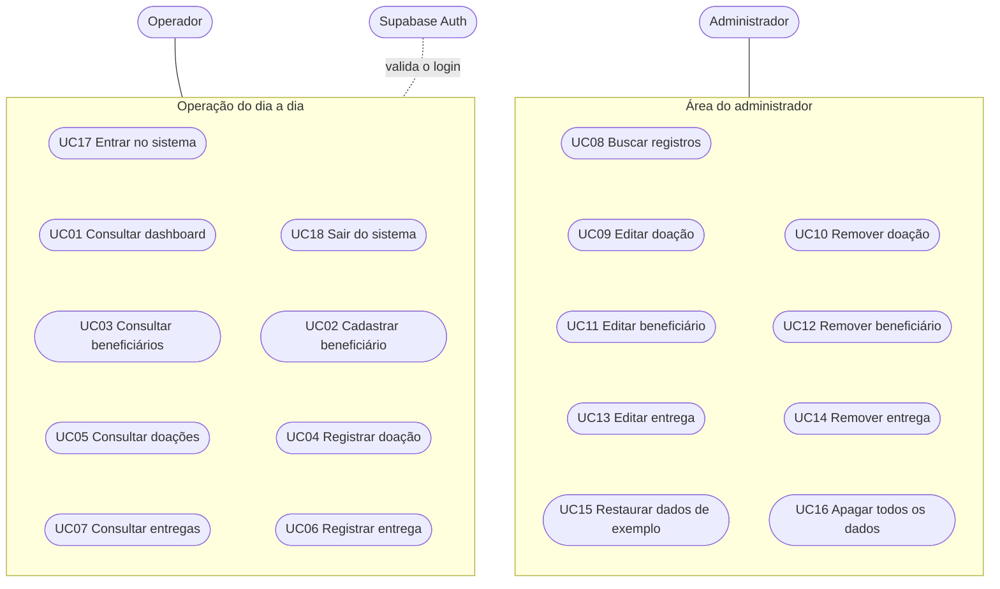
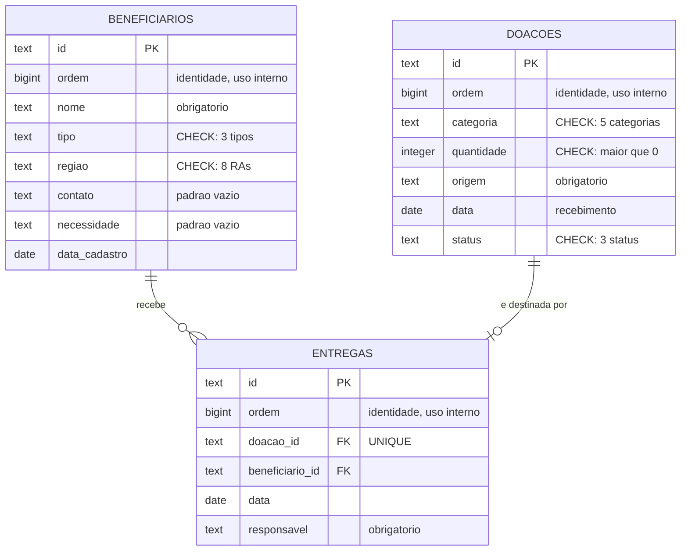
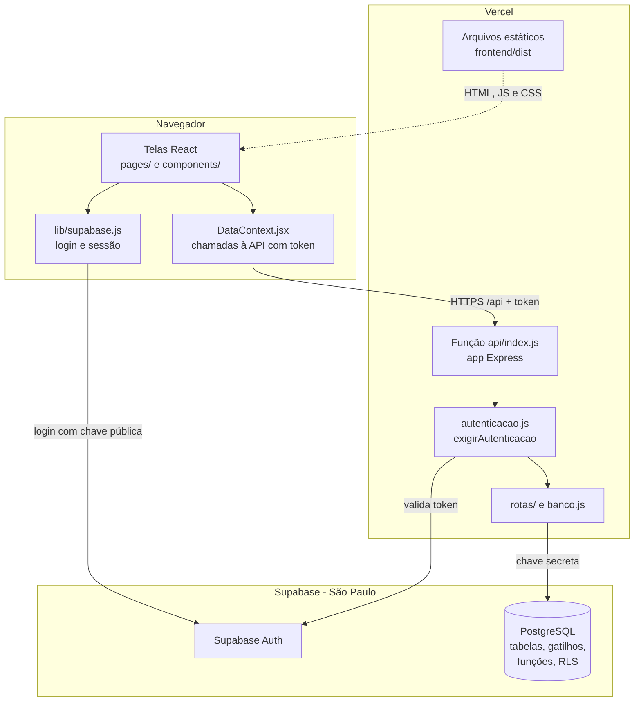
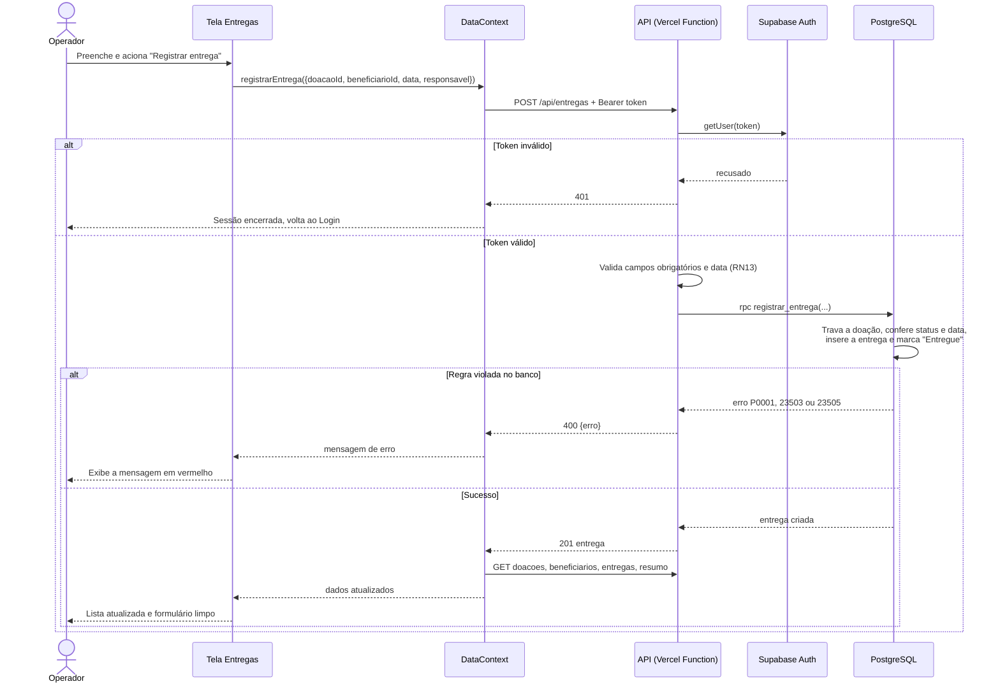
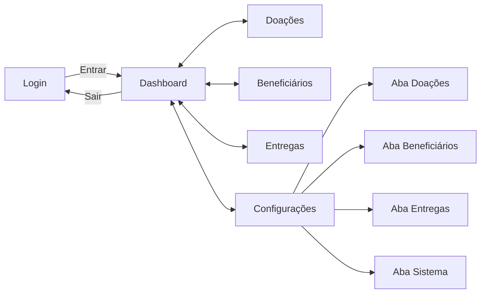
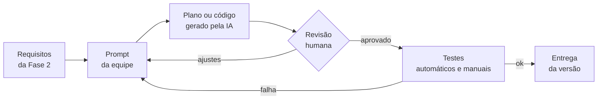
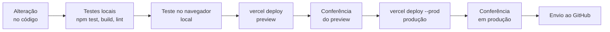

# Documentação Técnica — Sistema Liga Candanga Solidária

**Projeto de Extensão:** Liga Candanga Solidária: sistema de controle de doações e fortalecimento da rede solidária da Liga Candanga de Futsal do DF
**Unidade Curricular:** Cooperação, Humanismo Solidário, Redes e Comunidades — Universidade Católica de Brasília (UCB), 2026/2
**Professora:** Juliana Olinda Martins Pequeno
**Instituição parceira:** Liga Candanga de Futsal do DF — QI 08, Conjunto I, Lote 74, Guará I, Brasília/DF
**Versão do sistema documentada:** v3 (conforme `PROGRESSO.md`), em produção em https://liga-candanga-solidaria.vercel.app
**Situação deste documento:** Completo — Seções 1 a 12. Atualizado em 22/10/2026

---

## Nota preliminar sobre a versão documentada

Este documento descreve **somente o que está implementado no código-fonte** da pasta `sistema-Liga-candanga-solitaria-main`. Pontos que não puderam ser confirmados no código foram marcados como **[A CONFIRMAR]**.

**Histórico.** Na primeira leitura do código (versão v2), o sistema divergia do Projeto de Extensão (itens 2.4 e 2.7): guardava os dados em um arquivo JSON (`backend/dados.json`) e não tinha deploy, enquanto o projeto previa Supabase e Vercel. Na versão **v3**, a equipe migrou o sistema:

| Aspecto | Projeto de Extensão (PDF) | v2 | v3 (atual) |
|---|---|---|---|
| Persistência | Banco de dados Supabase | Arquivo JSON no servidor | **Supabase (PostgreSQL)**, região São Paulo |
| Hospedagem | Vercel | Sem deploy | **Vercel** (site estático + função Node.js) |
| Autenticação | Não especificada | Nenhuma | **Supabase Auth** (e-mail e senha, sem auto-cadastro) |
| Servidor | Não especificado | API REST em Node.js + Express 5 | A mesma API, executada como Vercel Function |

Com a v3, a divergência deixou de existir e o texto do Projeto de Extensão sobre Vercel e Supabase passou a corresponder ao sistema.

Todas as seções descrevem a v3. Comparações com versões anteriores aparecem só onde ajudam a mostrar a evolução do sistema: requisitos atendidos (2.4), lacunas fechadas (3.6), novas recusas da API (6.6), histórico de versões (8.1) e defeitos corrigidos (9.7).

---

## 1. Visão geral

### 1.1 Contexto

A Liga Candanga de Futsal do DF reúne equipes filiadas de diferentes regiões administrativas (RAs) do Distrito Federal e já desenvolve ações sociais: arrecadação de cestas básicas, doação de materiais esportivos a escolinhas de base e concessão de vagas na competição principal a equipes de torneios menores. O programa **Liga Candanga Solidária**, proposto no projeto de extensão, busca transformar essas iniciativas pontuais em uma política permanente, alinhada ao **ODS 10 — Redução das Desigualdades (Meta 10.2)** e, de forma complementar, aos ODS 2, 3, 4 e 17.

O sistema descrito aqui é uma das cinco frentes do programa (o cadastro de beneficiários) e serve de apoio às frentes de registro e mensuração. As demais frentes (calendário solidário, rodadas solidárias e selo "Equipe Solidária") são conduzidas fora do sistema.

### 1.2 Problema

O Formulário de Mapeamento da Realidade e o Projeto de Extensão apontam três problemas centrais. Eles são usados como referência de rastreabilidade em todo o documento:

| Código | Problema do diagnóstico | Evidência no diagnóstico |
|---|---|---|
| **P1** | **Falta de continuidade** das ações sociais | As ações "ocorrem de forma pontual e sem calendário fixo" e dependem de momentos específicos, não de um compromisso permanente |
| **P2** | **Falta de cadastro** estruturado de beneficiários | Há "dependência de indicações informais para identificar quem precisa de apoio", o que deixa de fora instituições sem contato direto com a Liga |
| **P3** | **Falta de mensuração** do impacto | Há "ausência de um sistema estruturado de registro e mensuração de impacto (quantidade de cestas arrecadadas, famílias atendidas, escolas beneficiadas)" |

O diagnóstico trata esses problemas como encadeados: uma ação sem continuidade não gera dados, sem dados não há divulgação convincente e, sem divulgação, não surgem novas parcerias.

### 1.3 Objetivo do sistema

**Objetivo geral.** Oferecer à Liga Candanga uma ferramenta web para cadastrar beneficiários, registrar e acompanhar doações e entregas e consultar indicadores consolidados. A ferramenta corresponde ao Objetivo Específico 2 do projeto de extensão.

**Objetivos específicos (verificáveis no código):**

1. Centralizar, em um único cadastro compartilhado, as famílias, escolinhas e instituições que podem receber doações (combate a P2).
2. Registrar cada lote de doação recebido, com categoria, quantidade, origem, data e situação (combate a P1 e P3).
3. Registrar a entrega de cada lote a um beneficiário, com data e responsável, e atualizar automaticamente a situação da doação (combate a P1 e P3).
4. Exibir um painel com totais e distribuições que resumem as ações registradas (combate a P3).
5. Permitir a correção e a remoção de registros sem perder a consistência entre doações, beneficiários e entregas.

### 1.4 Escopo

**Incluído na versão v3 (implementado):**

| Módulo | Funções | Local no código |
|---|---|---|
| Acesso | Login por e-mail e senha e saída do sistema | `frontend/src/pages/Login.jsx`, `frontend/src/App.jsx`, `backend/autenticacao.js` |
| Dashboard | Totais, doações por categoria, beneficiários por RA, últimas entregas | `frontend/src/pages/Dashboard.jsx`, `backend/rotas/resumo.js` |
| Doações | Cadastro e listagem | `frontend/src/pages/Doacoes.jsx`, `backend/rotas/doacoes.js` |
| Beneficiários | Cadastro e listagem | `frontend/src/pages/Beneficiarios.jsx`, `backend/rotas/beneficiarios.js` |
| Entregas | Registro e listagem | `frontend/src/pages/Entregas.jsx`, `backend/rotas/entregas.js` |
| Configurações (área do administrador) | Busca, edição e remoção de doações, beneficiários e entregas; restaurar dados de exemplo; apagar todos os dados | `frontend/src/pages/configuracoes/`, `backend/rotas/sistema.js` |

A v3 também trouxe a infraestrutura prevista no Projeto de Extensão: banco de dados no Supabase, hospedagem na Vercel e login da equipe (Seções 5 e 6).

**Fora do escopo da versão v3 (não implementado):**

| Item | Origem da previsão |
|---|---|
| Perfis de acesso distintos (Operador e Administrador) | Análise desta documentação (Seção 1.6) |
| Registro de quem alterou cada dado (trilha de auditoria) | Análise desta documentação (Seção 6.7) |
| Mapa interativo (Leaflet.js) das RAs atendidas | README e PROGRESSO |
| Fracionamento de uma doação entre vários beneficiários | README |
| Relatório de impacto exportável | README e PROGRESSO; Projeto de Extensão, item 2.9 ("relatórios/planilhas exportados a partir do dashboard") |
| Formulário para os próprios beneficiários informarem suas necessidades | Formulário de Mapeamento, item 2.4 (frente 4 do programa) |
| Calendário solidário, rodadas solidárias e selo "Equipe Solidária" | Frentes do programa sem representação no sistema. **[A CONFIRMAR]** se alguma delas deve entrar no sistema |

**Premissas e simplificações assumidas no código:**

- Cada doação é tratada como **lote único**, entregue integralmente a um único beneficiário (README, "Simplificação assumida").
- A origem da doação (equipe, torcida, parceiro) é um **texto livre**, não um cadastro próprio de doadores.
- A lista de RAs é fixa e contém **8 das 35 RAs do DF**: Ceilândia, Guará, Taguatinga, Samambaia, Planaltina, Recanto das Emas, Santa Maria e São Sebastião (`frontend/src/lib/constantes.js`).

### 1.5 Público-alvo

| Grupo | Relação com o sistema |
|---|---|
| Equipe da Liga Candanga (diretoria e voluntários responsáveis pelas ações sociais) | **Usuários diretos**: entram com conta própria, cadastram, registram e consultam. Quem exatamente vai operar o sistema: **[A CONFIRMAR com a Liga]** |
| Famílias em situação de vulnerabilidade, escolinhas de futsal e instituições parceiras das RAs atendidas | **Beneficiários**: são registros do sistema e não o acessam |
| Equipes filiadas, torcidas e comércio local (doadores) | Aparecem apenas como texto no campo "Origem" das doações |
| Parceiros, patrocinadores e órgãos públicos | Destinatários indiretos dos indicadores, por meio de relatórios produzidos pela Liga |
| Equipe acadêmica (UCB) | Desenvolvimento, validação e manutenção durante o projeto |

### 1.6 Tipos de usuário

Desde a v3, o sistema **exige login**: só entra quem tem conta no Supabase Auth do projeto, e a API recusa qualquer chamada sem uma sessão válida. As contas são criadas pelo responsável técnico no painel do Supabase, e o auto-cadastro está desligado.

O sistema, porém, **não implementa perfis de acesso**: toda conta tem as mesmas permissões, inclusive na área de Configurações e nas ações "Restaurar exemplo" e "Apagar tudo".

A interface separa duas áreas de uso, o que permite descrever dois **perfis lógicos**. A separação é só de navegação e **não é imposta pelo sistema**:

| Perfil lógico | Telas | Operações | Controle no código |
|---|---|---|---|
| Operador (registro do dia a dia) | Dashboard, Doações, Beneficiários, Entregas | Consultar indicadores; cadastrar e listar doações, beneficiários e entregas | Login obrigatório |
| Administrador | Configurações (abas Doações, Beneficiários, Entregas e Sistema) | Buscar, editar e remover registros; restaurar dados de exemplo; apagar todos os dados | Login obrigatório, sem verificação de perfil. A tela se descreve como "Área do administrador" |

Fora do sistema existe ainda o papel de **responsável técnico**, que administra o projeto no painel do Supabase (cria e bloqueia contas) e na Vercel (publicação e variáveis de ambiente). Quem exerce esse papel depois do projeto de extensão está **[A CONFIRMAR com a Liga]**.

---

## 2. Análise de requisitos

### 2.1 Critério de prioridade

As prioridades seguem o escopo definido no Projeto de Extensão (Fase 3) e as versões registradas em `PROGRESSO.md`:

- **Essencial**: compõe o MVP definido no projeto (módulos de beneficiários, doações, entregas e dashboard), entregue na v1, ou é condição para publicar o sistema com dados reais (login, banco e hospedagem), entregue na v3.
- **Importante**: mantém a qualidade e a consistência dos dados ao longo do uso (edição, remoção e busca), entregue na v1.1.
- **Desejável**: apoia a demonstração e a operação, mas não é indispensável ao objetivo do sistema.

A coluna "Problema" faz a rastreabilidade para P1 (continuidade), P2 (cadastro) e P3 (mensuração), definidos na Seção 1.2.

### 2.2 Requisitos funcionais

| ID | Requisito | Descrição (comportamento implementado) | Prioridade | Problema | Fonte no código |
|---|---|---|---|---|---|
| **RF01** | Cadastrar beneficiário | Registrar nome (obrigatório), tipo (Família, Escolinha ou Instituição), RA (lista fixa), contato e necessidade principal. A data de cadastro é atribuída pelo servidor | Essencial | P2 | `pages/Beneficiarios.jsx`; `rotas/beneficiarios.js` (POST) |
| **RF02** | Listar beneficiários | Exibir nome, tipo, região, contato e necessidade, do cadastro mais recente para o mais antigo | Essencial | P2 | `pages/Beneficiarios.jsx`; `rotas/beneficiarios.js` (GET) |
| **RF03** | Editar beneficiário | Alterar nome, tipo, região, contato e necessidade de um beneficiário existente | Importante | P2 | `configuracoes/AbaBeneficiarios.jsx`; `rotas/beneficiarios.js` (PUT) |
| **RF04** | Remover beneficiário | Excluir beneficiário após confirmação, desde que não tenha entregas (RN19) | Importante | P2 | `configuracoes/AbaBeneficiarios.jsx`; `rotas/beneficiarios.js` (DELETE) |
| **RF05** | Registrar doação | Registrar categoria (Cesta básica, Bola, Rede, Troféu ou Uniforme), quantidade, origem e data de recebimento (padrão: data atual). A doação nasce com status "Disponível" | Essencial | P1, P3 | `pages/Doacoes.jsx`; `rotas/doacoes.js` (POST) |
| **RF06** | Listar doações com situação | Exibir categoria, quantidade, origem, data e status (etiqueta colorida), da mais recente para a mais antiga | Essencial | P1, P3 | `pages/Doacoes.jsx`; `components/StatusBadge.jsx` |
| **RF07** | Editar doação | Alterar categoria, quantidade, origem, data e status ("Disponível" ou "Reservada"), respeitando RN08 a RN10 | Importante | P1, P3 | `configuracoes/AbaDoacoes.jsx`; `rotas/doacoes.js` (PUT) |
| **RF08** | Remover doação | Excluir doação após confirmação, desde que não tenha entrega (RN18) | Importante | P3 | `configuracoes/AbaDoacoes.jsx`; `rotas/doacoes.js` (DELETE) |
| **RF09** | Registrar entrega | Vincular uma doação "Disponível" a um beneficiário, com responsável e data (padrão: data atual; mínimo: data de recebimento). Ao salvar, a doação passa a "Entregue" | Essencial | P1, P3 | `pages/Entregas.jsx`; `rotas/entregas.js` (POST) |
| **RF10** | Listar entregas | Exibir data, doação (categoria e quantidade), beneficiário e responsável, da mais recente para a mais antiga | Essencial | P1, P3 | `pages/Entregas.jsx`; `rotas/entregas.js` (GET) |
| **RF11** | Editar entrega | Alterar beneficiário, data e responsável. A doação vinculada não pode ser trocada (RN16) | Importante | P3 | `configuracoes/AbaEntregas.jsx`; `rotas/entregas.js` (PUT) |
| **RF12** | Remover entrega | Excluir entrega após confirmação, com aviso de que a doação voltará a "Disponível" (RN17) | Importante | P1, P3 | `configuracoes/AbaEntregas.jsx`; `rotas/entregas.js` (DELETE) |
| **RF13** | Exibir dashboard de indicadores | Mostrar: (a) total de doações, doações disponíveis, beneficiários e entregas; (b) doações por categoria; (c) beneficiários por RA; (d) as cinco entregas mais recentes | Essencial | P3 | `pages/Dashboard.jsx`; `rotas/resumo.js` |
| **RF14** | Buscar registros | Filtrar, na área de Configurações, doações (categoria, origem, status), beneficiários (nome, tipo, região, contato) e entregas (doação, beneficiário, responsável), por texto e sem diferenciar maiúsculas de minúsculas | Importante | P2, P3 | `configuracoes/comum.jsx` e abas |
| **RF15** | Restaurar dados de exemplo | Substituir todos os registros pelos dados de demonstração (6 doações, 3 beneficiários, 2 entregas), após confirmação | Desejável | — | `configuracoes/AbaSistema.jsx`; `rotas/sistema.js`; `backend/seed.js` |
| **RF16** | Apagar todos os dados | Esvaziar doações, beneficiários e entregas para iniciar o uso real, após confirmação | Desejável | — | `configuracoes/AbaSistema.jsx`; `rotas/sistema.js` |
| **RF17** | Exibir totais armazenados | Mostrar, na aba Sistema, a quantidade atual de doações, beneficiários e entregas | Desejável | P3 | `configuracoes/AbaSistema.jsx` |
| **RF24** | Entrar no sistema | Autenticar o usuário por e-mail e senha antes de exibir qualquer tela ou dado, com mensagens em português para credenciais inválidas, e-mail não confirmado, acesso bloqueado e excesso de tentativas | Essencial | P1 | `pages/Login.jsx`; `App.jsx`; `backend/autenticacao.js` |
| **RF25** | Sair do sistema | Encerrar a sessão pelo botão "Sair" e, automaticamente, quando a API recusar a sessão (expirada ou inválida) | Essencial | P1 | `components/Layout.jsx`; `lib/DataContext.jsx` |

Os números RF18 a RF23 identificam requisitos ainda não atendidos (Seção 2.4). Por isso os requisitos de acesso, entregues na v3, receberam RF24 e RF25.

### 2.3 Requisitos não funcionais

| ID | Categoria | Requisito (como é atendido no código) | Prioridade | Problema | Situação |
|---|---|---|---|---|---|
| **RNF01** | Portabilidade e usabilidade | A interface deve funcionar em celular e computador. Atendido com meta *viewport*, *breakpoints* do Tailwind (`sm`, `lg`), tabelas com rolagem horizontal, menu rolável e janelas modais que abrem a partir da base da tela no celular. Corresponde ao critério de aceite 3 do projeto | Essencial | P1 | Atendido. O teste em aparelho real com a Liga está **[A CONFIRMAR]** |
| **RNF02** | Usabilidade | A interface deve estar em português do Brasil: `lang="pt-BR"`, todos os textos em português e ordenação alfabética com `localeCompare(..., 'pt-BR')` | Essencial | — | Atendido |
| **RNF03** | Integridade | As regras de negócio devem ser aplicadas no servidor, que é a fonte da verdade. A API recusa operações inválidas com HTTP 400 e `{ "erro": "mensagem" }`, e o banco reforça as regras com restrições, gatilhos e transações (Seção 5.4). A interface repete parte das validações (campos obrigatórios, data mínima) só para orientar o usuário | Essencial | P3 | Atendido |
| **RNF04** | Persistência e compartilhamento | Os dados devem ficar no servidor e ser compartilhados entre todos os usuários. Atendido com banco PostgreSQL no Supabase, região São Paulo (Seção 5.1). Na v2, o armazenamento era um arquivo JSON | Essencial | P1 | Atendido |
| **RNF05** | Custo | O sistema não deve gerar custo de licença para a Liga. Todas as dependências são de código aberto (Express, React, React Router, Vite, Tailwind CSS, supabase-js, oxlint). A hospedagem usa o plano Hobby (gratuito) da Vercel | Essencial | P1 | Atendido para software e para a Vercel. O plano do Supabase usado pelo projeto está **[A CONFIRMAR]** |
| **RNF06** | Usabilidade (retorno ao usuário) | O sistema deve confirmar ações irreversíveis e informar o motivo de operações recusadas. Atendido com janelas de confirmação de remoção, aviso na remoção de entrega, mensagens de erro da API em todos os formulários de cadastro e edição, mensagens de lista vazia e datas pré-preenchidas com o dia atual no fuso local | Importante | — | Atendido. Até 22/10/2026, as telas de cadastro de Doações e Beneficiários não exibiam a mensagem de erro da API (CT43, corrigido) |
| **RNF07** | Acessibilidade | A interface deve ter recursos básicos de acessibilidade: rótulos (`<label>`) em todos os campos; modais com `role="dialog"`, `aria-modal` e `aria-labelledby`; fechamento com a tecla Esc; botão de fechar com `aria-label`; abas com `role="tab"` e `aria-selected` | Desejável | — | Atendido nos itens citados. Não houve auditoria WCAG **[A CONFIRMAR]** |
| **RNF08** | Implantação | O sistema deve ser publicado de forma simples e repetível. Em produção, a Vercel serve o frontend e executa a API como função, conforme `vercel.json`. São necessárias quatro variáveis de ambiente (Seção 6.3). Localmente, o Express também pode servir tudo em um único processo | Importante | P1 | Atendido |
| **RNF09** | Manutenibilidade | O código deve permitir evolução por outras pessoas: backend e frontend separados; acesso a dados isolado em `backend/banco.js`; um único ponto de comunicação com a API (`DataContext.jsx`); listas de domínio centralizadas (`constantes.js`); esquema do banco versionado em migrações SQL; 35 testes automatizados da API; verificação estática com oxlint | Importante | P1 | Atendido |
| **RNF10** | Desempenho e escala | O volume deve ser compatível com o piloto (cerca de 25 famílias e 5 escolinhas, segundo o item 2.6 do projeto). A cada alteração, o frontend recarrega todos os dados, e o resumo é calculado a partir das três tabelas completas. Não há meta de desempenho definida | Desejável | — | **[A CONFIRMAR]**: não há medição registrada |
| **RNF11** | Segurança (autenticação) | Só usuários com conta podem acessar telas e dados. Login por e-mail e senha no Supabase Auth, sem auto-cadastro; toda rota da API exige token válido e responde 401 sem ele | Essencial | P1, P2 | Atendido (verificado em produção) |
| **RNF12** | Proteção de dados pessoais (LGPD) | Os dados de beneficiários (nome e contato) só devem ser acessíveis à equipe autorizada. Atendido com login, HTTPS, RLS no banco e armazenamento no Brasil | Essencial | P2 | Parcial: falta definir com a Liga quem pode ver os dados e por quanto tempo são guardados **[A CONFIRMAR]** |
| **RNF13** | Banco de dados gerenciado | Os dados devem ficar em banco gerenciado, com integridade garantida pelo próprio banco. Atendido com Supabase (PostgreSQL) | Importante | P1 | Atendido. A rotina de cópia de segurança está **[A CONFIRMAR]** |
| **RNF14** | Hospedagem pública | O sistema deve estar acessível pela internet, no celular e no computador. Atendido na Vercel: https://liga-candanga-solidaria.vercel.app | Essencial | P1 | Atendido |

### 2.4 Requisitos identificados e ainda não atendidos

Os requisitos abaixo **não existem no código**. Foram listados para manter a rastreabilidade com o diagnóstico e com as metas do projeto, e não fazem parte da descrição do sistema atual.

Na v2, esta tabela também trazia RNF11 (autenticação), RNF12 (LGPD), RNF13 (banco gerenciado) e RNF14 (hospedagem pública). Eles foram atendidos na v3, o RNF12 parcialmente, e passaram para a Seção 2.3.

| ID | Requisito | Origem | Problema | Prioridade sugerida |
|---|---|---|---|---|
| RNF15 | **Perfis de acesso**: restringir a área de Configurações e a Zona de risco a administradores. Hoje toda conta tem acesso total | Análise desta documentação | P1 | Importante |
| RNF16 | **Trilha de auditoria**: registrar quem fez cada alteração e quando | Análise desta documentação | P3 | Importante |
| RNF17 | **Cópia de segurança e disponibilidade**: rotina de *backup* e prevenção da pausa automática do plano gratuito do Supabase | Análise desta documentação (Seção 6.7) | P1 | Importante |
| RF18 | **Indicadores por quantidade de itens e por beneficiários atendidos**. Ver a análise crítica (2.5) | Projeto de Extensão, item 2.6 | P3 | Essencial para o relatório de impacto |
| RF19 | **Relatório de impacto exportável** (planilha ou PDF), com filtro por período | README; Projeto de Extensão, itens 2.8 e 2.9 | P3 | Importante |
| RF20 | **Mapa interativo** das RAs atendidas (Leaflet.js) | README / PROGRESSO | P3 | Desejável |
| RF21 | **Fracionamento** de uma doação entre vários beneficiários | README | P3 | Desejável |
| RF22 | **Lista completa das 35 RAs do DF**: hoje só 8 estão disponíveis | Análise desta documentação | P2 | Importante |
| RF23 | **Formulário público** para escolinhas e instituições informarem suas necessidades | Formulário de Mapeamento, item 2.4 | P2 | **[A CONFIRMAR]** com a Liga |

### 2.5 Análise crítica: aderência aos problemas do diagnóstico

**P2 — Cadastro (atendido, com ressalvas).** RF01 a RF04 substituem as indicações informais por um cadastro único e compartilhado, com tipo, região e necessidade. Há duas limitações. A lista com 8 RAs impede registrar com precisão beneficiários de outras regiões, justamente o "alcance limitado das demandas" apontado no diagnóstico. E o cadastro é feito só pela equipe da Liga, então instituições sem contato com a Liga continuam fora dele (RF23).

**P1 — Continuidade (atendido, com ressalvas).** O registro persistente e o status das doações ("Disponível", "Reservada", "Entregue") criam um histórico que não depende da memória de uma pessoa e mostram o que ainda falta entregar. Desde a v3, o sistema está publicado na internet (RNF14), protegido por login (RNF11) e com os dados em banco gerenciado (RNF13). Restam três ressalvas. O Supabase e a Vercel estão em contas pessoais do coordenador da equipe, não da Liga; a transferência para contas da instituição ao fim do projeto está **[A CONFIRMAR]**. O plano gratuito do Supabase pode pausar o projeto em períodos sem uso, justamente o intervalo entre campanhas (RNF17). E ainda precisa ser definido quem administrará contas e publicação depois do projeto de extensão (Seção 1.6).

**P3 — Mensuração (atendido parcialmente; lacuna relevante).** O dashboard (RF13) **conta registros, não itens**. Exemplo com os dados de demonstração: duas doações de cestas básicas, uma com 40 e outra com 25 unidades, aparecem como "Cesta básica: 2", e não 65. Do mesmo modo, "Beneficiários por região" conta beneficiários **cadastrados**, não **atendidos**. As metas do item 2.6 do projeto ("no mínimo 50 cestas básicas e 75 itens esportivos", "cerca de 25 famílias") não podem ser lidas diretamente no painel. Além disso, o cadastro de beneficiário não tem campo para o número de pessoas atendidas, de modo que a meta "cerca de 225 pessoas beneficiadas diretamente" não é mensurável no sistema. RF18 e RF19 tratam essa lacuna.

### 2.6 Matriz de rastreabilidade (requisito × problema)

| Requisito | P1 Continuidade | P2 Cadastro | P3 Mensuração |
|---|:---:|:---:|:---:|
| RF01 a RF04 (beneficiários) | | ● | |
| RF05 a RF08 (doações) | ● | | ● |
| RF09 a RF12 (entregas) | ● | | ● |
| RF13 (dashboard) | | | ● |
| RF14 (busca) | | ● | ● |
| RF17 (totais armazenados) | | | ● |
| RNF01 (responsividade) | ● | | |
| RNF03 (regras no servidor) | | | ● |
| RNF04 (persistência compartilhada) | ● | | |
| RNF05 (custo zero de licença) | ● | | |
| RNF08 e RNF09 (implantação e manutenção) | ● | | |
| RF24, RF25 e RNF11 (login e controle de acesso) | ● | ● | |
| RNF12 (proteção de dados pessoais) | | ● | |
| RNF13 e RNF14 (banco gerenciado e hospedagem pública) | ● | | |

---

## 3. Regras de negócio

As regras abaixo foram extraídas do código da v3. A coluna "Aplicação" indica onde cada regra é garantida:

- **API**: validação no servidor Express, que devolve a mensagem ao usuário;
- **Banco**: restrição, gatilho ou função no PostgreSQL (Seção 5.4), que vale até para acessos fora da API;
- **Interface**: a tela orienta ou impede a ação antes do envio.

### 3.1 Beneficiários

| ID | Regra | Aplicação | Mensagem ao usuário | Fonte |
|---|---|---|---|---|
| **RN01** | O beneficiário precisa ter nome não vazio. Espaços nas extremidades são removidos | API, Banco e Interface | "O nome é obrigatório." | `rotas/beneficiarios.js`; `CHECK` em `beneficiarios.nome` |
| **RN02** | A data de cadastro é atribuída pela API no momento do cadastro, no fuso de Brasília, e não pode ser editada | API | — | `rotas/beneficiarios.js`; `util.js` (`hojeLocal`) |
| **RN03** | O tipo deve ser Família, Escolinha ou Instituição, e a região deve ser uma das 8 RAs da lista | API, Banco e Interface | "Selecione um tipo e uma região administrativa válidos." | `constantes.js`; `CHECK` em `tipo` e `regiao` |
| **RN04** | Contato e necessidade principal são opcionais. Quando ausentes, são gravados como texto vazio | API e Banco | — | `rotas/beneficiarios.js`; padrão `''` no banco |

### 3.2 Doações

| ID | Regra | Aplicação | Mensagem ao usuário | Fonte |
|---|---|---|---|---|
| **RN05** | A doação precisa ter origem não vazia e quantidade inteira maior que zero | API, Banco e Interface | "Preencha a origem e uma quantidade inteira maior que zero." | `rotas/doacoes.js` (`validarDoacao`); `CHECK` em `quantidade` e `origem` |
| **RN06** | A categoria deve ser Cesta básica, Bola, Rede, Troféu ou Uniforme | API, Banco e Interface | "Selecione uma categoria válida." | `constantes.js`; `CHECK` em `categoria` |
| **RN07** | Toda doação nasce com status "Disponível". A API ignora qualquer status enviado no cadastro | API e Banco (valor padrão) | — | `rotas/doacoes.js` (POST) |
| **RN08** | Os status possíveis são "Disponível", "Reservada" e "Entregue". "Reservada" só pode ser definida manualmente, na edição | Banco e Interface | "Selecione um status válido." | `CHECK` em `status`; `AbaDoacoes.jsx` |
| **RN09** | Uma doação só passa a "Entregue" com o registro de uma entrega. A edição manual para "Entregue" é recusada | Banco (gatilho) | "Para marcar como Entregue, registre uma entrega na tela de Entregas." | Gatilho `doacoes_validar_status` |
| **RN10** | Enquanto houver entrega vinculada, o status da doação não pode deixar de ser "Entregue" | Banco (gatilho) | "Esta doação já tem uma entrega registrada. Remova a entrega para mudar o status." | Gatilho `doacoes_validar_status` |
| **RN11** | Se houver entrega vinculada, a data de recebimento da doação não pode ser posterior à data da entrega | Banco (gatilho) | "A data de recebimento não pode ser posterior à entrega (*data*)." | Gatilho `doacoes_validar_status` |
| **RN12** | A data de recebimento é preenchida por padrão com a data atual do dispositivo, no fuso local | Interface | — | `lib/datas.js` |
| **RN29** | A data de recebimento é obrigatória e deve ser uma data real no formato `AAAA-MM-DD` | API, Banco (`NOT NULL`) e Interface | "Informe uma data de recebimento válida." | `rotas/doacoes.js`; `util.js` (`dataValida`) |

### 3.3 Entregas

| ID | Regra | Aplicação | Mensagem ao usuário | Fonte |
|---|---|---|---|---|
| **RN13** | A entrega exige doação, beneficiário e responsável não vazio | API, Banco e Interface | "Selecione a doação, o beneficiário e informe o responsável." | `rotas/entregas.js` (POST); `CHECK` em `responsavel` |
| **RN14** | Só uma doação com status "Disponível" pode ser entregue. Doações "Reservada" ou "Entregue" não aparecem para seleção e são recusadas | Banco (função) e Interface | "Esta doação não está disponível para entrega." | Função `registrar_entrega`; `pages/Entregas.jsx` |
| **RN15** | A data da entrega não pode ser anterior à data de recebimento da doação, no registro e na edição | Banco (gatilho) e Interface (data mínima no campo) | "A data da entrega não pode ser anterior ao recebimento da doação (*data*)." | Gatilho `entregas_validar_data` |
| **RN16** | Ao registrar a entrega, o status da doação passa automaticamente para "Entregue", na mesma transação | Banco (função) | — | Função `registrar_entrega` |
| **RN17** | Cada doação é um lote único: tem no máximo uma entrega e um beneficiário. Mesmo duas tentativas simultâneas resultam em uma só entrega | Banco (`UNIQUE` e trava da linha) | "Esta doação não está disponível para entrega." | `UNIQUE` em `entregas.doacao_id`; função `registrar_entrega` |
| **RN18** | Na edição de uma entrega só podem mudar o beneficiário, a data e o responsável. Para trocar a doação, é preciso remover a entrega e registrar outra | API e Interface | "Para trocar a doação, remova esta entrega e registre uma nova." | `rotas/entregas.js` (PUT); `AbaEntregas.jsx` |
| **RN19** | O responsável pela entrega é obrigatório também na edição | API e Banco | "Informe o responsável pela entrega." | `rotas/entregas.js` (PUT) |
| **RN20** | A data da entrega é preenchida por padrão com a data atual do dispositivo | Interface | — | `pages/Entregas.jsx` |
| **RN30** | A data da entrega é obrigatória e deve ser uma data real no formato `AAAA-MM-DD` | API, Banco (`NOT NULL`) e Interface | "Informe uma data de entrega válida." | `rotas/entregas.js`; `util.js` (`dataValida`) |
| **RN31** | O beneficiário da entrega precisa existir, no registro e na edição | API e Banco (chave estrangeira) | "Beneficiário não encontrado." | `rotas/entregas.js`; `banco.js` |

### 3.4 Remoção e integridade referencial

| ID | Regra | Aplicação | Mensagem ao usuário | Fonte |
|---|---|---|---|---|
| **RN21** | Não é permitido remover uma doação que tenha entrega registrada | API e Banco (`ON DELETE RESTRICT`) | "Esta doação já foi entregue. Remova a entrega antes de remover a doação." | `rotas/doacoes.js` (DELETE) |
| **RN22** | Não é permitido remover um beneficiário que tenha entregas registradas | API e Banco (`ON DELETE RESTRICT`) | "Este beneficiário tem *n* entrega(s) registrada(s). Remova as entregas antes." | `rotas/beneficiarios.js` (DELETE) |
| **RN23** | Remover uma entrega devolve a doação ao status "Disponível", na mesma transação. A interface avisa antes da confirmação | Banco (função) e Interface | "A doação voltará a ficar Disponível para uma nova entrega." | Função `remover_entrega`; `AbaEntregas.jsx` |
| **RN24** | Toda remoção exige confirmação explícita e é definitiva: não há lixeira nem histórico | Interface | "Tem certeza que deseja remover (...)? Essa ação não pode ser desfeita." | `components/Modal.jsx` (`ConfirmarRemocao`) |

### 3.5 Administração do sistema e indicadores

| ID | Regra | Aplicação | Fonte |
|---|---|---|---|
| **RN25** | "Restaurar exemplo" substitui **todos** os registros pelos dados de demonstração, e "Apagar tudo" remove todos os registros. As duas ações exigem confirmação, rodam em transação única e são irreversíveis | Banco (funções) e Interface | Funções `restaurar_exemplo` e `apagar_tudo`; `AbaSistema.jsx` |
| **RN26** | Os indicadores do dashboard são calculados pela API a cada consulta, a partir dos registros atuais, sem histórico nem fotografia por período | API | `rotas/resumo.js` |
| **RN27** | "Doações recebidas" e "Doações por categoria" contam **registros (lotes)**, não unidades. "Doações disponíveis" conta só o status "Disponível" (doações "Reservada" ficam de fora). "Beneficiários por região" conta beneficiários cadastrados, com ou sem entrega | API | `rotas/resumo.js` |
| **RN28** | Os identificadores são gerados pela API no formato `prefixo-carimboDeTempo-aleatório` (por exemplo, `doacao-...`, `entrega-...`) | API | `util.js` (`gerarId`) |

### 3.6 Lacunas observadas e situação na v3

A versão v2 tinha quatro lacunas na aplicação das regras. A v3 fechou três delas:

| Lacuna na v2 | Situação na v3 |
|---|---|
| Tipo, região e categoria eram garantidos só pela interface; uma chamada direta à API aceitava outros valores | **Fechada**: validados na API (RN03, RN06) e no banco (`CHECK`) |
| A API não verificava se o beneficiário da entrega existia | **Fechada**: verificado pela chave estrangeira (RN31) |
| A API aceitava doação e entrega sem data | **Fechada**: datas obrigatórias e validadas (RN29, RN30) |
| Doações "Reservada" podiam ser removidas ou voltar a "Disponível" sem restrição, e não havia registro de para quem foi feita a reserva | **Mantida**: comportamento igual ao da v2 |

Lacunas que permanecem na v3 e devem orientar o plano de testes (Seção 9) e as próximas versões:

1. A reserva de doação não registra o beneficiário nem o motivo (item 4 da tabela acima).
2. Todas as contas têm as mesmas permissões: qualquer integrante com login pode usar "Apagar tudo" (RNF15).
3. Não há registro de quem fez cada alteração (RNF16).

### 3.7 Acesso ao sistema

| ID | Regra | Aplicação | Mensagem ao usuário | Fonte |
|---|---|---|---|---|
| **RN32** | Só usuários autenticados podem ver telas ou consultar e alterar dados. Toda chamada à API exige token de sessão válido | API e Interface | "Sessão expirada ou inválida. Entre novamente." (API, 401) | `autenticacao.js`; `App.jsx` |
| **RN33** | As contas são criadas pelo responsável técnico no painel do Supabase. Não há auto-cadastro nem link de cadastro na tela de Login | Supabase Auth e Interface | — | Configuração do projeto Supabase; `config.toml`; `pages/Login.jsx` |
| **RN34** | Se a API recusar a sessão, o sistema encerra a sessão e volta à tela de Login | Interface | — | `lib/DataContext.jsx` |
| **RN35** | Se o serviço de autenticação estiver fora do ar, a API responde 503 e a sessão **não** é encerrada | API | "Não foi possível validar a sessão agora. Tente novamente em instantes." | `autenticacao.js` |

---

## 4. Casos de uso

### 4.1 Atores

| Ator | Tipo | Descrição |
|---|---|---|
| **Operador** | Primário | Integrante da equipe da Liga que registra as ações do dia a dia: cadastra beneficiários, registra doações e entregas e consulta o dashboard |
| **Administrador** | Primário (especializa o Operador) | Integrante da equipe da Liga que, além das funções do Operador, corrige e remove registros e gerencia os dados do sistema na tela Configurações |
| **Supabase Auth** | Secundário (sistema externo) | Serviço que verifica e-mail e senha no login e valida a sessão a cada chamada à API |

Os dois atores primários precisam estar autenticados (UC17), mas são **papéis lógicos**: o sistema exige login e não distingue perfis, de modo que toda conta pode executar todos os casos de uso (Seção 1.6). Beneficiários e doadores **não são atores**, porque não interagem com o sistema; eles aparecem apenas como dados registrados pela equipe. A criação de contas é feita pelo responsável técnico no painel do Supabase, fora do sistema.

### 4.2 Diagrama de casos de uso



### 4.3 Lista de casos de uso

| ID | Caso de uso | Ator | Requisitos | Regras de negócio | Tela |
|---|---|---|---|---|---|
| UC01 | Consultar dashboard | Operador | RF13 | RN26, RN27 | Dashboard |
| UC02 | Cadastrar beneficiário | Operador | RF01 | RN01 a RN04 | Beneficiários |
| UC03 | Consultar beneficiários | Operador | RF02 | — | Beneficiários |
| UC04 | Registrar doação | Operador | RF05 | RN05 a RN07, RN12, RN29 | Doações |
| UC05 | Consultar doações | Operador | RF06 | — | Doações |
| UC06 | Registrar entrega | Operador | RF09 | RN13 a RN17, RN20, RN30, RN31 | Entregas |
| UC07 | Consultar entregas | Operador | RF10 | — | Entregas |
| UC08 | Buscar registros | Administrador | RF14 | — | Configurações (abas Doações, Beneficiários e Entregas) |
| UC09 | Editar doação | Administrador | RF07 | RN05, RN06, RN08 a RN11, RN29 | Configurações › Doações |
| UC10 | Remover doação | Administrador | RF08 | RN21, RN24 | Configurações › Doações |
| UC11 | Editar beneficiário | Administrador | RF03 | RN01, RN03, RN04 | Configurações › Beneficiários |
| UC12 | Remover beneficiário | Administrador | RF04 | RN22, RN24 | Configurações › Beneficiários |
| UC13 | Editar entrega | Administrador | RF11 | RN15, RN18, RN19, RN30, RN31 | Configurações › Entregas |
| UC14 | Remover entrega | Administrador | RF12 | RN23, RN24 | Configurações › Entregas |
| UC15 | Restaurar dados de exemplo | Administrador | RF15, RF17 | RN25 | Configurações › Sistema |
| UC16 | Apagar todos os dados | Administrador | RF16, RF17 | RN25 | Configurações › Sistema |
| UC17 | Entrar no sistema | Operador | RF24 | RN32, RN33, RN35 | Login |
| UC18 | Sair do sistema | Operador | RF25 | RN34 | Cabeçalho (botão Sair) |

### 4.4 Descrição detalhada dos principais casos de uso

Foram detalhados o acesso ao sistema, os casos de uso que formam o fluxo central do programa (cadastrar, receber, entregar e medir) e os que alteram dados já registrados. Os fluxos descrevem o comportamento observado no código.

**Observações comuns a todos os casos de uso (exceto UC17).**

- **Pré-condição:** o usuário está autenticado (UC17).
- **Sessão recusada:** se a sessão expirar ou for recusada durante o uso, a API responde 401 e o sistema volta à tela de Login (RN34).
- **Atualização dos dados:** o frontend carrega todos os dados ao abrir o sistema e volta a carregá-los depois de cada alteração feita **no mesmo navegador**. Alterações feitas por outra pessoa, em outro aparelho, só aparecem depois que a página é recarregada (`frontend/src/lib/DataContext.jsx`).

---

#### UC17 — Entrar no sistema

| Item | Descrição |
|---|---|
| **Ator** | Operador (primário) e Supabase Auth (secundário) |
| **Objetivo** | Identificar-se para acessar as telas e os dados do programa |
| **Pré-condição** | O usuário tem conta criada pelo responsável técnico no painel do Supabase |
| **Pós-condição** | A sessão fica guardada no navegador e o Dashboard é exibido |

**Fluxo principal**

1. O Operador abre o endereço do sistema.
2. Sem sessão ativa, o sistema exibe a tela de Login, com os campos E-mail e Senha.
3. O Operador informa e-mail e senha e aciona **Entrar**.
4. O sistema desabilita o botão, exibe "Entrando..." e envia as credenciais ao Supabase Auth.
5. O Supabase Auth confirma as credenciais e devolve a sessão.
6. O sistema carrega os dados e exibe o Dashboard (UC01).

**Fluxos alternativos**

- **A1 — Sessão já ativa (passo 2):** se o usuário entrou antes no mesmo navegador e a sessão continua válida, o sistema vai direto ao Dashboard.
- **A2 — Credenciais incorretas (passo 5):** o sistema exibe "E-mail ou senha incorretos." e mantém o e-mail preenchido.
- **A3 — Muitas tentativas seguidas (passo 5):** o sistema exibe "Muitas tentativas seguidas. Aguarde alguns minutos e tente novamente."
- **A4 — Conta bloqueada (passo 5):** o sistema exibe "Este acesso está bloqueado. Fale com a coordenação da Liga."

**Fluxo de exceção**

- **E1 — Falha de conexão (passo 4):** o sistema exibe "Não foi possível entrar. Verifique a conexão e tente novamente."

O caso UC18 (Sair do sistema) consiste em acionar **Sair** no cabeçalho: o sistema encerra a sessão e volta à tela de Login.

---

#### UC01 — Consultar dashboard

| Item | Descrição |
|---|---|
| **Ator** | Operador |
| **Objetivo** | Visualizar os indicadores consolidados do programa |
| **Pré-condição** | O usuário está autenticado |
| **Pós-condição** | Nenhuma alteração de dados |

**Fluxo principal**

1. O Operador entra no sistema ou aciona **Dashboard** no menu. O Dashboard é a página inicial.
2. O sistema exibe quatro indicadores: Doações recebidas, Doações disponíveis, Beneficiários cadastrados e Entregas realizadas.
3. O sistema exibe a lista "Doações por categoria" com as cinco categorias, inclusive as que têm zero registros.
4. O sistema exibe a lista "Beneficiários por região administrativa", só com as regiões que têm ao menos um beneficiário.
5. O sistema exibe a tabela "Últimas entregas", com até cinco entregas, da mais recente para a mais antiga.

**Fluxos alternativos**

- **A1 — Sem beneficiários (passo 4):** o sistema exibe "Nenhum beneficiário cadastrado ainda."
- **A2 — Sem entregas (passo 5):** o sistema exibe "Nenhuma entrega registrada ainda."

**Fluxo de exceção**

- **E1 — Falha ao carregar os dados (passo 1):** se a API ou o banco não responderem, o sistema exibe "Não foi possível conectar ao servidor. Verifique se o backend está rodando." e nenhuma tela é carregada. Isso também ocorre se o projeto do Supabase estiver pausado (Seção 6.7).

---

#### UC02 — Cadastrar beneficiário

| Item | Descrição |
|---|---|
| **Ator** | Operador |
| **Objetivo** | Incluir uma família, escolinha ou instituição no cadastro do programa |
| **Pré-condição** | O sistema está carregado |
| **Pós-condição** | O beneficiário fica gravado, com identificador e data de cadastro, e passa a aparecer na lista, no dashboard e na seleção de entregas |

**Fluxo principal**

1. O Operador acessa o menu **Beneficiários**.
2. O sistema exibe o formulário (Tipo: "Família" e Região: "Ceilândia" já selecionados) e a lista de beneficiários.
3. O Operador informa o nome, escolhe tipo e região e, se quiser, informa contato e necessidade principal.
4. O Operador aciona **Cadastrar beneficiário**.
5. O sistema envia os dados à API, que valida nome, tipo e região (RN01, RN03), atribui identificador e data de cadastro (RN02) e grava o registro no banco.
6. O sistema atualiza a lista e limpa os campos Nome, Contato e Necessidade. Tipo e Região mantêm a última escolha, para agilizar cadastros em sequência.

**Fluxos alternativos**

- **A1 — Nome em branco (passo 4):** o navegador impede o envio e destaca o campo obrigatório. Se o nome tiver apenas espaços, o formulário não é enviado e o sistema exibe, em vermelho abaixo do botão, "O nome é obrigatório."
- **A2 — Recusa pela API (passo 5):** o sistema exibe, em vermelho abaixo do botão, a mensagem devolvida pela API (por exemplo, "Selecione um tipo e uma região administrativa válidos.") e mantém os campos preenchidos para correção.

---

#### UC04 — Registrar doação

| Item | Descrição |
|---|---|
| **Ator** | Operador |
| **Objetivo** | Registrar um lote de doação recebido pela Liga |
| **Pré-condição** | O sistema está carregado |
| **Pós-condição** | A doação fica gravada com status "Disponível" e passa a aparecer na lista, no dashboard e na seleção de entregas |

**Fluxo principal**

1. O Operador acessa o menu **Doações**.
2. O sistema exibe o formulário (Categoria: "Cesta básica"; Data de recebimento: data atual) e a lista de doações.
3. O Operador escolhe a categoria e informa a quantidade, a origem (equipe, torcida ou parceiro) e a data de recebimento.
4. O Operador aciona **Registrar doação**.
5. A API valida origem, quantidade, categoria e data (RN05, RN06, RN29), atribui o status "Disponível" (RN07) e grava o registro no banco.
6. O sistema atualiza a lista, onde a doação aparece com a etiqueta "Disponível", e limpa os campos Quantidade e Origem.

**Fluxos alternativos**

- **A1 — Quantidade inválida (passo 4):** com quantidade vazia, zero, negativa ou fracionária, o navegador impede o envio (campo numérico com mínimo 1 e passo 1).
- **A2 — Origem em branco ou só com espaços (passo 4):** o formulário não é enviado. Se a origem tiver apenas espaços, o sistema exibe "Preencha a origem e uma quantidade inteira maior que zero."
- **A3 — Recusa pela API (passo 5):** o sistema exibe, em vermelho abaixo do botão, a mensagem devolvida pela API (por exemplo, "Informe uma data de recebimento válida.") e mantém os campos preenchidos para correção.

---

#### UC06 — Registrar entrega

| Item | Descrição |
|---|---|
| **Ator** | Operador |
| **Objetivo** | Registrar que um lote de doação foi entregue a um beneficiário |
| **Pré-condições** | Existe ao menos uma doação com status "Disponível" e ao menos um beneficiário cadastrado |
| **Pós-condição** | A entrega fica gravada, a doação passa a "Entregue" (RN16) e deixa de aparecer entre as disponíveis |

**Fluxo principal**

1. O Operador acessa o menu **Entregas**.
2. O sistema exibe o formulário e a lista de entregas. O campo **Doação disponível** lista só as doações com status "Disponível", no formato "categoria · quantidade un. · origem" (RN14).
3. O Operador seleciona a doação. O sistema passa a usar a data de recebimento dessa doação como data mínima da entrega.
4. O Operador seleciona o beneficiário (formato "nome · região"), informa o responsável pela entrega e confirma ou altera a data (padrão: data atual).
5. O Operador aciona **Registrar entrega**.
6. A API confere os campos obrigatórios e a data (RN13, RN30). Em seguida, o banco, em uma única transação, confere se a doação ainda está disponível (RN14), se o beneficiário existe (RN31) e se a data não é anterior ao recebimento (RN15), grava a entrega e altera o status da doação para "Entregue" (RN16).
7. O sistema atualiza a lista e limpa Doação, Beneficiário e Responsável.

**Fluxos alternativos**

- **A1 — Não há doações disponíveis (passo 2):** o botão fica desabilitado e o sistema exibe "Não há doações disponíveis para vincular no momento."
- **A2 — Não há beneficiários (passo 2):** o botão fica desabilitado, sem mensagem explicativa.
- **A3 — Data anterior ao recebimento (passo 5):** o navegador impede o envio por causa da data mínima. Se a validação do navegador for contornada, o servidor recusa e o sistema exibe, em vermelho, "A data da entrega não pode ser anterior ao recebimento da doação (*data*)". A mensagem some quando a data é alterada.
- **A4 — Doação deixou de estar disponível (passo 6):** se outra pessoa entregou a mesma doação antes, mesmo que no mesmo instante, o sistema exibe "Esta doação não está disponível para entrega." (RN17).

---

#### UC09 — Editar doação

| Item | Descrição |
|---|---|
| **Ator** | Administrador |
| **Objetivo** | Corrigir dados de uma doação ou marcá-la como "Reservada" |
| **Pré-condição** | A doação existe |
| **Pós-condição** | A doação fica gravada com os novos dados |

**Fluxo principal**

1. O Administrador acessa **Configurações**. A aba **Doações** abre por padrão.
2. Se quiser, o Administrador filtra a lista pelo campo de busca (UC08).
3. O Administrador aciona **Editar** na linha da doação.
4. O sistema abre uma janela com os dados atuais: categoria, quantidade, origem, data de recebimento e status.
5. O Administrador altera os campos desejados e aciona **Salvar alterações**.
6. A API valida origem, quantidade, categoria e data (RN05, RN06, RN29). O banco aplica as regras de status e de data (RN08 a RN11) e grava a doação.
7. O sistema fecha a janela e atualiza a lista.

**Fluxos alternativos**

- **A1 — Cancelamento (passos 4 e 5):** **Cancelar**, o botão ×, a tecla Esc ou um clique fora da janela fecham a janela sem salvar.
- **A2 — Marcar como "Entregue" sem entrega (passo 6):** o sistema exibe, dentro da janela, "Para marcar como Entregue, registre uma entrega na tela de Entregas."
- **A3 — Mudar o status de doação já entregue (passo 6):** o sistema exibe "Esta doação já tem uma entrega registrada. Remova a entrega para mudar o status."
- **A4 — Data de recebimento posterior à entrega (passo 6):** o sistema exibe "A data de recebimento não pode ser posterior à entrega (*data*)."

---

#### UC12 — Remover beneficiário

| Item | Descrição |
|---|---|
| **Ator** | Administrador |
| **Objetivo** | Excluir um beneficiário cadastrado por engano ou que deixou de ser atendido |
| **Pré-condição** | O beneficiário existe |
| **Pós-condição** | O beneficiário é excluído definitivamente |

**Fluxo principal**

1. O Administrador acessa **Configurações › Beneficiários**. A tabela mostra, para cada beneficiário, a quantidade de entregas recebidas.
2. O Administrador aciona **Remover** na linha do beneficiário.
3. O sistema pede confirmação: "Tem certeza que deseja remover *nome*? Essa ação não pode ser desfeita."
4. O Administrador aciona **Remover**.
5. A API confirma que não há entregas vinculadas (RN22) e exclui o registro. O banco também impede a exclusão por meio da chave estrangeira.
6. O sistema fecha a janela e atualiza a lista.

**Fluxos alternativos**

- **A1 — Cancelamento (passo 3):** a janela é fechada e nada é alterado.
- **A2 — Beneficiário com entregas (passo 5):** o sistema exibe, na janela, "Este beneficiário tem *n* entrega(s) registrada(s). Remova as entregas antes." O botão **Remover** é ocultado e só fica disponível **Cancelar**.

---

#### UC14 — Remover entrega

| Item | Descrição |
|---|---|
| **Ator** | Administrador |
| **Objetivo** | Desfazer uma entrega registrada por engano |
| **Pré-condição** | A entrega existe |
| **Pós-condição** | A entrega é excluída e a doação volta ao status "Disponível" (RN23) |

**Fluxo principal**

1. O Administrador acessa **Configurações › Entregas**.
2. O Administrador aciona **Remover** na linha da entrega.
3. O sistema pede confirmação, descrevendo "a entrega de *doação* para *beneficiário*", e avisa: "A doação voltará a ficar Disponível para uma nova entrega."
4. O Administrador aciona **Remover**.
5. O banco, em uma única transação, exclui a entrega e devolve a doação ao status "Disponível" (função `remover_entrega`).
6. O sistema fecha a janela e atualiza a lista.

**Fluxo alternativo**

- **A1 — Cancelamento (passo 3):** a janela é fechada e nada é alterado.

---

#### UC16 — Apagar todos os dados

| Item | Descrição |
|---|---|
| **Ator** | Administrador |
| **Objetivo** | Esvaziar o sistema, por exemplo para sair dos dados de demonstração e começar o uso real |
| **Pré-condição** | Nenhuma |
| **Pós-condição** | Não resta nenhuma doação, beneficiário ou entrega |

**Fluxo principal**

1. O Administrador acessa **Configurações › Sistema**.
2. O sistema exibe os totais armazenados (RF17) e a "Zona de risco".
3. O Administrador aciona **Apagar tudo**.
4. O sistema pede confirmação, informando que a ação não pode ser desfeita.
5. O Administrador aciona **Confirmar**.
6. O banco remove entregas, doações e beneficiários em uma única transação (função `apagar_tudo`, RN25).
7. O sistema exibe "Todos os dados foram apagados." e os totais passam a zero.

**Fluxo alternativo**

- **A1 — Cancelamento (passo 4):** a janela é fechada e nada é alterado.

O caso UC15 (Restaurar dados de exemplo) segue o mesmo fluxo, com o botão **Restaurar exemplo** e a mensagem final "Dados de exemplo restaurados."

---

## 5. Modelo de dados

### 5.1 Forma de armazenamento

A partir da versão v3, os dados ficam em um banco **PostgreSQL gerenciado pelo Supabase**, no projeto `liga-candanga-solidaria`, hospedado na região São Paulo (`sa-east-1`). O esquema foi escrito à mão, como migração SQL versionada no repositório: `backend/supabase/migrations/20261021160000_schema_inicial.sql`.

| Característica | Comportamento implementado |
|---|---|
| Estrutura | Três tabelas no esquema `public`: `beneficiarios`, `doacoes` e `entregas` |
| Acesso | Exclusivamente pela API, com a chave secreta do servidor (`service_role`), por meio de `@supabase/supabase-js` (`backend/supabase.js`). O navegador não acessa as tabelas |
| Integridade | Garantida em duas camadas: a API valida os dados e devolve mensagens amigáveis (Seção 3), e o banco reforça as regras com restrições, chaves estrangeiras, gatilhos e funções transacionais (Seção 5.4) |
| Concorrência | Operações que alteram duas tabelas (registrar ou remover entrega) rodam em uma única transação no banco, com trava da linha da doação (`FOR UPDATE`) |
| Ordem das listas | A coluna interna `ordem` (identidade crescente) registra a ordem de inserção. As listas da API são devolvidas da mais nova para a mais antiga, como na v2 |
| Estado inicial | O banco começa vazio. Os dados de demonstração são carregados pela ação "Restaurar exemplo" (RF15) |
| Ambiente local | A mesma migração roda em um Supabase local (Docker), criado com `npx supabase start` e `npx supabase db reset`, usado no desenvolvimento e nos testes automatizados |
| Cópia de segurança | Depende do plano do Supabase. A política de *backup* do plano gratuito para este projeto está **[A CONFIRMAR]** |

O modelo descrito a seguir é **físico**, extraído da migração SQL. Na API, os nomes das colunas são convertidos de `snake_case` para `camelCase` em `backend/banco.js` (por exemplo, `data_cadastro` vira `dataCadastro`), de modo que o formato do JSON é o mesmo da v2.

### 5.2 Entidades e relacionamentos

| Entidade | Tabela | Descrição |
|---|---|---|
| **Beneficiário** | `beneficiarios` | Família, escolinha ou instituição apta a receber doações |
| **Doação** | `doacoes` | Lote de itens recebido pela Liga, de uma única categoria e origem |
| **Entrega** | `entregas` | Destinação de uma doação a um beneficiário, em uma data, por um responsável. É a tabela associativa entre as outras duas |

| Relacionamento | Cardinalidade | Como o banco garante |
|---|---|---|
| Beneficiário **recebe** Entrega | 1 beneficiário : 0..N entregas | Chave estrangeira `entregas.beneficiario_id` → `beneficiarios.id`, com `ON DELETE RESTRICT` |
| Doação **é destinada por** Entrega | 1 doação : 0..1 entrega | Chave estrangeira `entregas.doacao_id` → `doacoes.id`, com `ON DELETE RESTRICT` e restrição `UNIQUE` em `doacao_id` |

A restrição `UNIQUE` em `entregas.doacao_id` implementa no banco a simplificação do lote único (RN17): uma doação nunca tem duas entregas, mesmo que duas pessoas tentem registrá-las ao mesmo tempo.



### 5.3 Dicionário de dados

Convenções: todas as colunas são `NOT NULL`. "Obrigatório" (texto) significa a restrição `CHECK (btrim(coluna) <> '')`, que recusa texto vazio ou só com espaços. Os identificadores (`id`) são texto gerado pela API no formato `prefixo-carimboDeTempo-aleatório` (RN28); nos dados de exemplo são curtos (`d1`, `b1`, `e1`). A coluna `ordem` existe nas três tabelas, é preenchida pelo banco e **não é exposta** pela API.

**Tabela `beneficiarios`**

| Coluna | Campo na API | Tipo | Restrições | Descrição |
|---|---|---|---|---|
| `id` | `id` | `text` | Chave primária | Identificador único (`beneficiario-...`) |
| `ordem` | — | `bigint` | Identidade gerada pelo banco | Ordem de inserção |
| `nome` | `nome` | `text` | Obrigatório | Nome da família, escolinha ou instituição |
| `tipo` | `tipo` | `text` | `CHECK` em `Família`, `Escolinha`, `Instituição` | Tipo de beneficiário |
| `regiao` | `regiao` | `text` | `CHECK` nas 8 RAs: Ceilândia, Guará, Taguatinga, Samambaia, Planaltina, Recanto das Emas, Santa Maria, São Sebastião | Região administrativa do DF |
| `contato` | `contato` | `text` | Padrão `''` | Telefone ou e-mail. **Dado pessoal** quando o beneficiário é família |
| `necessidade` | `necessidade` | `text` | Padrão `''` | Necessidade principal informada |
| `data_cadastro` | `dataCadastro` | `date` | — | Data de inclusão, atribuída pela API no fuso de Brasília; não editável |

**Tabela `doacoes`**

| Coluna | Campo na API | Tipo | Restrições | Descrição |
|---|---|---|---|---|
| `id` | `id` | `text` | Chave primária | Identificador único (`doacao-...`) |
| `ordem` | — | `bigint` | Identidade gerada pelo banco | Ordem de inserção |
| `categoria` | `categoria` | `text` | `CHECK` em `Cesta básica`, `Bola`, `Rede`, `Troféu`, `Uniforme` | Categoria dos itens do lote |
| `quantidade` | `quantidade` | `integer` | `CHECK (quantidade > 0)` | Quantidade de unidades no lote |
| `origem` | `origem` | `text` | Obrigatório | Quem doou (equipe, torcida, parceiro) |
| `data` | `data` | `date` | — | Data de recebimento |
| `status` | `status` | `text` | `CHECK` em `Disponível`, `Reservada`, `Entregue`; padrão `Disponível` | Situação do lote (regras RN07 a RN10, RN16 e RN23) |

**Tabela `entregas`**

| Coluna | Campo na API | Tipo | Restrições | Descrição |
|---|---|---|---|---|
| `id` | `id` | `text` | Chave primária | Identificador único (`entrega-...`) |
| `ordem` | — | `bigint` | Identidade gerada pelo banco | Ordem de inserção |
| `doacao_id` | `doacaoId` | `text` | Chave estrangeira para `doacoes.id`, `ON DELETE RESTRICT`, `UNIQUE` | Doação entregue. Não pode ser trocada depois (RN18) |
| `beneficiario_id` | `beneficiarioId` | `text` | Chave estrangeira para `beneficiarios.id`, `ON DELETE RESTRICT`; índice `entregas_beneficiario_id_idx` | Beneficiário que recebeu |
| `data` | `data` | `date` | Gatilho: não pode ser anterior à data da doação | Data da entrega |
| `responsavel` | `responsavel` | `text` | Obrigatório | Nome de quem fez a entrega (texto livre, não ligado às contas de login) |

### 5.4 Regras implementadas no banco

| Mecanismo | Objeto | O que garante | Regras |
|---|---|---|---|
| Restrições `CHECK` | Colunas `tipo`, `regiao`, `categoria`, `status`, `quantidade` e textos obrigatórios | Domínios válidos e campos preenchidos, também para acessos fora da API | RN01, RN03, RN05, RN06, RN08, RN13, RN19 |
| Chaves estrangeiras com `ON DELETE RESTRICT` | `entregas.doacao_id` e `entregas.beneficiario_id` | Não há entrega para doação ou beneficiário inexistente, nem remoção de registros que tenham entrega | RN21, RN22 |
| Restrição `UNIQUE` | `entregas.doacao_id` | Uma doação tem no máximo uma entrega | RN17 |
| Gatilho `entregas_validar_data` | Antes de inserir ou alterar uma entrega | A data da entrega não é anterior ao recebimento da doação | RN15 |
| Gatilho `doacoes_validar_status` | Antes de alterar uma doação | Doação com entrega continua "Entregue" e não tem recebimento posterior à entrega; doação sem entrega não pode ser marcada como "Entregue" | RN09, RN10, RN11 |
| Função `registrar_entrega` | Transação única | Trava a doação, confere se está "Disponível", insere a entrega e muda o status para "Entregue" | RN14, RN16 |
| Função `remover_entrega` | Transação única | Remove a entrega e devolve a doação para "Disponível" | RN23 |
| Função `apagar_tudo` | Transação única | Remove entregas, doações e beneficiários, nessa ordem | RN25 |
| Função `restaurar_exemplo` | Transação única | Apaga tudo e insere os dados de demonstração recebidos da API (`backend/seed.js`) | RN25 |

As mensagens de erro levantadas pelos gatilhos e funções são as mesmas exibidas na v2. A API (`backend/banco.js`) converte os erros do banco em respostas HTTP:

| Erro do PostgreSQL | Significado | Resposta da API |
|---|---|---|
| `P0001` | Exceção levantada por gatilho ou função | 400, com a mensagem do banco |
| `23503` | Violação de chave estrangeira | 400: "Beneficiário não encontrado." (entrega) ou mensagem de remoção bloqueada (doação ou beneficiário) |
| `23505` | Violação de `UNIQUE` (entrega duplicada) | 400: "Esta doação não está disponível para entrega." |
| `22003` | Número fora do intervalo (quantidade) | 400: "Preencha a origem e uma quantidade inteira maior que zero." |
| `23514` / `23502` | Violação de `CHECK` ou campo nulo no status | 400: "Selecione um status válido." |
| Outros | Falha inesperada | 500: "Erro interno ao acessar o banco de dados." (detalhe só no log do servidor) |

### 5.5 Dados derivados (não armazenados)

O endpoint `GET /api/resumo` (`backend/rotas/resumo.js`) lê as três tabelas e calcula os indicadores a cada consulta, sem gravá-los:

| Campo | Cálculo |
|---|---|
| `totalDoacoes` | Quantidade de registros de doação |
| `doacoesDisponiveis` | Quantidade de doações com status "Disponível" |
| `totalBeneficiarios` | Quantidade de registros de beneficiário |
| `totalEntregas` | Quantidade de registros de entrega |
| `doacoesPorCategoria` | Para cada uma das 5 categorias, a quantidade de **registros** (não de unidades) |
| `beneficiariosPorRegiao` | Para cada região presente no cadastro, a quantidade de beneficiários cadastrados |

O status "Entregue" da doação continua sendo um dado **redundante**: equivale à existência de uma entrega para ela. Na v3, a consistência dessa redundância é garantida pelo próprio banco, por meio do gatilho `doacoes_validar_status` e das funções `registrar_entrega` e `remover_entrega`.

### 5.6 Dados de exemplo

`backend/seed.js` traz dados fictícios de demonstração, identificados com "(exemplo)" no nome dos beneficiários. Eles só entram no banco pela ação "Restaurar exemplo", que chama a função `restaurar_exemplo`:

| Tabela | Registros | Conteúdo |
|---|:---:|---|
| `doacoes` | 6 | 2 de cesta básica (40 e 25 unidades), bolas, uniformes, redes ("Reservada") e troféus |
| `beneficiarios` | 3 | Uma escolinha (Guará), uma família (Ceilândia) e uma instituição (Samambaia) |
| `entregas` | 2 | Cestas básicas para a família e bolas para a escolinha |

### 5.7 Ambientes de banco de dados

| Ambiente | Onde roda | Como é criado | Uso |
|---|---|---|---|
| Local | Docker, no computador do desenvolvedor (API em `http://127.0.0.1:54321`, painel em `http://127.0.0.1:54323`) | `npx supabase start` e `npx supabase db reset` em `backend/` | Desenvolvimento e testes automatizados (`npm test`) |
| Produção | Supabase em nuvem, região São Paulo | `supabase link` e `supabase db push` | Uso real pela Liga |

O histórico de migrações aplicadas é controlado pela CLI do Supabase. Novas alterações de esquema devem ser feitas como novas migrações, escritas à mão e somente aditivas, aplicadas primeiro no ambiente local e depois em produção.

---

## 6. Arquitetura

### 6.1 Estilo arquitetural

O sistema segue uma arquitetura **cliente-servidor em três camadas**, com dois serviços gerenciados: a **Vercel** hospeda a interface e a API, e o **Supabase** fornece o banco de dados e a autenticação.

| Camada | Tecnologia | Responsabilidade |
|---|---|---|
| Apresentação | Aplicação de página única (SPA) em React, executada no navegador e servida pela Vercel | Exibir telas e formulários, fazer o login no Supabase Auth, enviar o token em cada chamada e mostrar as mensagens da API |
| Aplicação | API REST em Node.js + Express, executada como Vercel Function (`api/index.js`) | Exigir login, aplicar as regras de negócio (RNF03), calcular indicadores e gerar identificadores |
| Dados | PostgreSQL no Supabase | Guardar os dados e reforçar as regras de integridade (Seção 5.4) |
| Autenticação | Supabase Auth | Guardar as contas da equipe, emitir e validar os tokens de sessão |

A comunicação usa HTTPS e JSON. A API responde 401 sem login válido e 400 com `{ "erro": "mensagem" }` quando uma regra impede a operação.



### 6.2 Tecnologias

Versões declaradas em `package.json` e travadas em `package-lock.json`:

| Tecnologia | Versão | Camada | Uso no sistema |
|---|---|---|---|
| Node.js | 22.x na Vercel (definido em `package.json` da raiz). Localmente, 20.19+ ou 22.12+ | Servidor e build | Execução da API e das ferramentas de build |
| Express | 5.3.0 | Aplicação | Rotas da API, *middleware* de autenticação e arquivos estáticos no modo local |
| @supabase/supabase-js | 2.118.0 | Aplicação e apresentação | No backend, acesso ao banco e validação de tokens com a chave secreta. No frontend, só login e sessão com a chave pública |
| React / React DOM | 19.3.1 | Apresentação | Componentes e estado das telas |
| React Router DOM | 7.18.4 | Apresentação | Navegação com `HashRouter` (endereços no formato `/#/doacoes`) |
| Vite | 8.3.4 | Build | Servidor de desenvolvimento, *proxy* da API e geração do *build* |
| Tailwind CSS (+ @tailwindcss/vite) | 4.3.3 | Apresentação | Estilos utilitários e layout responsivo |
| oxlint | 1.88.0 | Qualidade | Análise estática do frontend (`npm run lint`) |
| Supabase (serviço) | PostgreSQL + Auth | Dados e autenticação | Banco de dados e contas da equipe, região São Paulo |
| Supabase CLI | 2.121.0 (dependência de desenvolvimento) | Ferramenta | Supabase local, migrações (`db reset`, `db push`) e ligação com o projeto |
| Vercel (serviço) | — | Hospedagem | Arquivos estáticos e função Node.js da API |
| Docker Desktop | — | Ferramenta | Execução do Supabase local |
| node:test | Nativo do Node.js | Qualidade | Testes automatizados da API (`backend/testes/api.test.js`) |

### 6.3 Modos de execução

| Modo | Como funciona | Endereço |
|---|---|---|
| **Produção** | A Vercel serve `frontend/dist` como site estático e encaminha `/api/*` para a função `api/index.js`, que reexporta o app Express. As variáveis de ambiente ficam no painel da Vercel | https://liga-candanga-solidaria.vercel.app |
| **Desenvolvimento** | Três processos: Supabase local (Docker), backend com `node --watch` na porta 3000 e frontend com o Vite na porta 5173. O Vite repassa `/api/...` para o backend (`frontend/vite.config.js`). `server.js` carrega `backend/.env` antes de importar o app | `http://localhost:5173` |
| **Apresentação local** | Depois do `npm run build` do frontend, o Express serve a API e os arquivos de `frontend/dist` em um único processo | `http://localhost:3000` |

A configuração da Vercel está em `vercel.json`:

| Propriedade | Valor | Motivo |
|---|---|---|
| `framework` | `null` | Evita a detecção automática de Express pela Vercel, que exige o app na raiz e ignora `express.static()` |
| `installCommand` | Instala `backend` (sem dependências de desenvolvimento) e `frontend` | A CLI do Supabase não é baixada no deploy |
| `buildCommand` | Build do frontend | Gera `frontend/dist` |
| `outputDirectory` | `frontend/dist` | Pasta publicada como site estático |
| `rewrites` | `/api/(.*)` → `/api` | Todas as rotas da API chegam à mesma função Express |

O arquivo `.vercelignore` impede o envio de arquivos `.env`, dos testes, da pasta do Supabase local e da documentação para a Vercel.

### 6.4 Estrutura de pastas

```
sistema-Liga-candanga-solitaria-main/
├── README.md                    Visão geral, setup, variáveis, API e segurança
├── PROGRESSO.md                 Versões (v1 a v3), decisões e próximas fases
├── package.json                 Raiz: módulo ES e Node 22 para a Vercel
├── vercel.json                  Configuração do deploy
├── .vercelignore                Arquivos que não vão para a Vercel
├── .gitignore                   node_modules, dist, .env*, .vercel, pastas temporárias do Supabase
├── api/
│   └── index.js                 Função da Vercel: reexporta o app Express
├── docs/
│   └── DOCUMENTACAO_TECNICA.md  Este documento
├── backend/
│   ├── package.json             Scripts start/dev/test; Express e supabase-js
│   ├── .env.example             Nomes das variáveis do backend
│   ├── app.js                   App Express: login em /api, rotas e arquivos estáticos
│   ├── server.js                Servidor local: carrega .env e chama listen
│   ├── autenticacao.js          Middleware exigirAutenticacao (token Bearer)
│   ├── supabase.js              Cliente do Supabase com a chave secreta
│   ├── banco.js                 Consultas, funções do banco e conversão de nomes
│   ├── constantes.js            Categorias, status, tipos e regiões
│   ├── erros.js                 ErroDeRegra (400) e responderErro (400/500)
│   ├── seed.js                  Dados de demonstração
│   ├── util.js                  gerarId, hojeLocal (fuso de Brasília) e dataValida
│   ├── rotas/                   doacoes, beneficiarios, entregas, resumo, sistema
│   ├── supabase/
│   │   ├── config.toml          Configuração do Supabase local (auto-cadastro desligado)
│   │   └── migrations/          20261021160000_schema_inicial.sql
│   └── testes/
│       └── api.test.js          35 testes da API contra o Supabase local
└── frontend/
    ├── package.json             Scripts dev/build/lint/preview
    ├── .env.example             Nomes das variáveis do frontend
    ├── vite.config.js           Plugins React e Tailwind; proxy /api
    ├── index.html               Página base (lang pt-BR, viewport)
    ├── public/                  favicon.svg (usado) e icons.svg (não referenciado)
    └── src/
        ├── main.jsx             Ponto de entrada do React
        ├── App.jsx              Controle de sessão: Login ou sistema
        ├── assets/              Sobras do modelo do Vite, não referenciadas
        ├── components/          Layout (com botão Sair), Modal, StatCard, StatusBadge, Field
        ├── lib/
        │   ├── supabase.js      Cliente do Supabase com a chave pública (login)
        │   ├── DataContext.jsx  Chamadas à API com token e estado global
        │   ├── constantes.js    Categorias, status, tipos e regiões
        │   └── datas.js         Data atual no fuso local
        └── pages/
            ├── Login.jsx
            ├── Dashboard.jsx, Doacoes.jsx, Beneficiarios.jsx, Entregas.jsx
            └── configuracoes/   Configuracoes, AbaDoacoes, AbaBeneficiarios, AbaEntregas, AbaSistema, comum
```

### 6.5 Componentes

**Backend**

| Módulo | Responsabilidade |
|---|---|
| `app.js` | Cria o app Express, ativa `express.json()`, aplica `exigirAutenticacao` a tudo que começa com `/api`, monta as cinco rotas e serve `frontend/dist` no modo local. Exporta o app, sem chamar `listen` |
| `server.js` | Uso local: carrega `backend/.env` (`process.loadEnvFile`), importa o app e inicia o servidor na porta `PORT` (padrão 3000) |
| `api/index.js` | Uso na Vercel: reexporta o app de `backend/app.js` como função |
| `autenticacao.js` | Lê o cabeçalho `Authorization: Bearer <token>` e o valida com `supabase.auth.getUser`. Token ausente ou recusado: 401. Supabase inacessível: 503, para que uma queda do serviço não encerre a sessão do usuário. Em caso de sucesso, guarda o usuário em `req.usuario` |
| `supabase.js` | Cria o cliente do Supabase com `SUPABASE_URL` e `SUPABASE_SERVICE_ROLE_KEY`, sem persistência de sessão |
| `banco.js` | Único ponto de acesso aos dados: funções assíncronas por entidade (`listarDoacoes`, `criarDoacao`, `registrarEntrega`...), conversão entre `snake_case` e `camelCase` e tradução dos erros do PostgreSQL (Seção 5.4) |
| `erros.js` | `ErroDeRegra` (erro de negócio, vira 400) e `responderErro` (tratador de erros das rotas: 400 para regra, 500 genérico para falha inesperada) |
| `util.js` | `gerarId(prefixo)`, `hojeLocal()` no fuso `America/Sao_Paulo` (a Vercel roda em UTC) e `dataValida(texto)`, que aceita só datas reais no formato `AAAA-MM-DD` |
| `constantes.js` | Listas de domínio usadas nas validações da API, iguais às do frontend e às restrições `CHECK` do banco |
| `rotas/*.js` | Um `Router` do Express por recurso: validação de entrada, chamada a `banco.js` e resposta HTTP |

**Frontend**

| Componente | Responsabilidade |
|---|---|
| `lib/supabase.js` | Cria o cliente do Supabase com `VITE_SUPABASE_URL` e `VITE_SUPABASE_ANON_KEY`. Indica se a configuração está presente |
| `App.jsx` | Sem configuração, mostra um aviso de configuração ausente. Com configuração, acompanha a sessão (`getSession` e `onAuthStateChange`): sem sessão, mostra a tela de Login; com sessão, mostra o sistema com as rotas `/`, `/doacoes`, `/beneficiarios`, `/entregas` e `/configuracoes` |
| `pages/Login.jsx` | Formulário de e-mail e senha (`signInWithPassword`), com mensagens em português para credenciais inválidas, e-mail não confirmado, acesso bloqueado e excesso de tentativas. Não há link de cadastro |
| `lib/DataContext.jsx` | Ao abrir, busca em paralelo doações, beneficiários, entregas e resumo. Envia o token da sessão em todas as chamadas. Ao receber 401, encerra a sessão (volta ao Login). Expõe os dados e as 11 operações de escrita, recarregando tudo depois de cada operação bem-sucedida |
| `components/Layout.jsx` | Cabeçalho, menu de navegação e botão **Sair** (`signOut`) |
| `components/Modal.jsx`, `StatCard.jsx`, `StatusBadge.jsx`, `Field.jsx` e `pages/configuracoes/comum.jsx` | Sem alteração em relação à v2 |

### 6.6 Interface da API

Todas as rotas começam com `/api`, trocam JSON e exigem o cabeçalho `Authorization: Bearer <token>`. Respostas comuns a todas as rotas:

| Situação | Resposta |
|---|---|
| Token ausente, mal formado, expirado ou inválido | 401: "Sessão expirada ou inválida. Entre novamente." |
| Supabase Auth inacessível | 503: "Não foi possível validar a sessão agora. Tente novamente em instantes." |
| Falha inesperada do banco | 500: "Erro interno ao acessar o banco de dados." |

| Método | Rota | Corpo da requisição | Respostas específicas |
|---|---|---|---|
| GET | `/doacoes` | — | 200: lista de doações |
| POST | `/doacoes` | `categoria`, `quantidade` (número), `origem`, `data` | 201: doação criada · 400 |
| PUT | `/doacoes/:id` | `categoria`, `quantidade`, `origem`, `data`, `status` | 200 · 400 · 404 |
| DELETE | `/doacoes/:id` | — | 204 · 400 (doação entregue) |
| GET | `/beneficiarios` | — | 200: lista de beneficiários |
| POST | `/beneficiarios` | `nome`, `tipo`, `regiao`, `contato`, `necessidade` | 201 · 400 |
| PUT | `/beneficiarios/:id` | Os mesmos campos do POST | 200 · 400 · 404 |
| DELETE | `/beneficiarios/:id` | — | 204 · 400 (possui entregas) |
| GET | `/entregas` | — | 200: lista de entregas |
| POST | `/entregas` | `doacaoId`, `beneficiarioId`, `data`, `responsavel` | 201 · 400 |
| PUT | `/entregas/:id` | `beneficiarioId`, `data`, `responsavel` (o `doacaoId` é ignorado) | 200 · 400 · 404 |
| DELETE | `/entregas/:id` | — | 204 · 404 |
| GET | `/resumo` | — | 200: indicadores (Seção 5.5) |
| POST | `/sistema/restaurar-exemplo` | — | 204 |
| POST | `/sistema/apagar-tudo` | — | 204 |

Novas recusas com 400 em relação à v2, que fecham as lacunas da Seção 3.6:

| Situação | Mensagem |
|---|---|
| Tipo ou região fora da lista | "Selecione um tipo e uma região administrativa válidos." |
| Categoria fora da lista | "Selecione uma categoria válida." |
| Status fora da lista | "Selecione um status válido." |
| Doação sem data válida | "Informe uma data de recebimento válida." |
| Entrega sem data válida | "Informe uma data de entrega válida." |
| Entrega para beneficiário inexistente | "Beneficiário não encontrado." |

Remover uma doação ou um beneficiário inexistente continua devolvendo 204, sem erro.

**Exemplo de interação (registro de entrega, UC06):**



### 6.7 Autenticação e segurança

**Fluxo de autenticação.**

1. As contas da equipe são criadas pelo administrador no painel do Supabase (Authentication › Users). O auto-cadastro está desligado, tanto no Supabase local (`config.toml`) quanto no projeto de produção.
2. Na tela de Login, o navegador envia e-mail e senha diretamente ao Supabase Auth, usando a chave pública. Em caso de sucesso, o `supabase-js` guarda a sessão no navegador e renova o token automaticamente.
3. Toda chamada à API leva o token no cabeçalho `Authorization`. O *middleware* `exigirAutenticacao` valida o token no Supabase Auth antes de qualquer rota.
4. Se a API responder 401, o frontend encerra a sessão e volta ao Login. O botão **Sair** também encerra a sessão.

**Autorização.** Todas as contas têm as mesmas permissões: o sistema não distingue os perfis Operador e Administrador (Seção 1.6). Qualquer pessoa da equipe com login pode editar, remover e usar "Apagar tudo".

**Situação de segurança da versão v3:**

| Aspecto | Situação no código | Risco |
|---|---|---|
| Controle de acesso | **Implementado**: login obrigatório na interface e em toda a API. Sem token válido, a API responde 401 (verificado em produção, inclusive para "Apagar tudo") | Baixo |
| Auto-cadastro | Desligado. Só o administrador cria contas | Baixo |
| Perfis de acesso | Não há: toda conta tem acesso total, inclusive às ações da Zona de risco | Médio: um erro de qualquer integrante pode apagar todos os dados |
| Dados pessoais (LGPD) | Nome e contato de famílias protegidos por login, trafegando só por HTTPS e guardados no Brasil (São Paulo) | Baixo a médio: falta definir quem pode ver os dados e por quanto tempo são guardados **[A CONFIRMAR com a Liga]** |
| Chave secreta (`service_role`) | Existe só no servidor: variável da Vercel marcada como secreta e `backend/.env` local, fora do Git e fora do deploy (`.vercelignore`) | Baixo |
| Chave pública (`anon`) | Fica no código do navegador, como previsto pelo Supabase. Com RLS ativo e sem políticas, ela não lê nem grava nenhuma tabela e não executa as funções (verificado em teste automatizado) | Baixo |
| Acesso direto ao banco | RLS ativo nas três tabelas; `anon` e `authenticated` sem permissões; funções executáveis só por `service_role` | Baixo |
| Integridade dos dados | Regras reforçadas no banco (Seção 5.4) e transações nas operações com duas tabelas | Baixo |
| Concorrência | Duas entregas simultâneas da mesma doação: uma é aceita e a outra recusada (verificado em teste automatizado) | Baixo |
| Trilha de auditoria | Não há registro de quem alterou o quê. O usuário autenticado fica disponível em `req.usuario`, mas não é gravado | Médio |
| Tentativas de login | O Supabase Auth aplica limites de taxa às tentativas de login; a tela mostra mensagem própria para esse caso. Os valores configurados no projeto estão **[A CONFIRMAR]** | Baixo |
| Cópia de segurança | Depende do plano do Supabase **[A CONFIRMAR]** | Médio |
| Disponibilidade | Projetos do plano gratuito do Supabase são pausados depois de um período sem uso, e precisam ser reativados no painel. O prazo exato está **[A CONFIRMAR]** no plano vigente | Médio: o sistema pode ficar fora do ar entre campanhas |
| Injeção de código na página (XSS) | O React escapa os textos exibidos; não há `dangerouslySetInnerHTML` | Baixo |
| Injeção de SQL | As consultas usam o cliente do Supabase (parâmetros, não texto SQL montado) e funções com `search_path` vazio | Baixo |
| Transporte | HTTPS fornecido pela Vercel e pelo Supabase | Baixo |
| Implantações de teste | As implantações de *preview* da Vercel exigem login na Vercel (Vercel Authentication). Só o domínio de produção é público | Baixo |

**Conclusão.** A v3 atende aos requisitos RNF11 (autenticação), RNF13 (banco gerenciado) e RNF14 (hospedagem pública), antes listados como pendentes na Seção 2.4, e atende parcialmente ao RNF12 (proteção de dados pessoais). Os riscos que restam são a ausência de perfis de acesso, de trilha de auditoria e de uma política de cópia de segurança confirmada.

### 6.8 Evolução prevista

- **Perfis de acesso**: separar Operador e Administrador, restringindo a área de Configurações e a Zona de risco.
- **Trilha de auditoria**: gravar o usuário (`req.usuario`) e o momento de cada alteração.
- **Cópia de segurança**: definir a rotina de *backup* compatível com o plano do Supabase.
- **Indicadores por itens e por beneficiários atendidos**, relatório exportável, mapa das RAs e lista completa das 35 RAs (Seção 2.4).

---

## 7. Interfaces

As telas foram descritas a partir do código do frontend (`frontend/src/pages/` e `frontend/src/components/`). Os locais marcados como **[Figura]** indicam onde inserir a captura de tela correspondente na versão final do documento.

### 7.1 Padrões visuais e de navegação

| Elemento | Padrão adotado |
|---|---|
| Cores | Verde-esmeralda para ações principais e item de menu ativo; vermelho para remoção, erros e Zona de risco; âmbar para avisos; fundo cinza-claro com cartões brancos |
| Status de doação | Etiquetas coloridas: azul para "Disponível", âmbar para "Reservada" e verde para "Entregue" (`StatusBadge.jsx`) |
| Formulários | Todo campo tem rótulo visível; campos obrigatórios são validados pelo navegador antes do envio |
| Janelas modais | Usadas para edição e confirmação; fecham com "Cancelar", com o botão ×, com a tecla Esc ou com um clique fora da janela. No celular, abrem a partir da base da tela |
| Tabelas | Rolagem horizontal no celular; mensagem própria quando estão vazias |
| Celular | Menu com rolagem horizontal; formulários em uma coluna; cartões do dashboard empilhados |
| Mensagens globais | "Carregando..." durante a carga; "Não foi possível conectar ao servidor..." quando a API ou o banco não respondem; aviso de "Configuração ausente" se o site for publicado sem as variáveis do Supabase |

**Mapa de navegação:**



Todas as telas, exceto o Login, compartilham o mesmo cabeçalho (`Layout.jsx`): o nome "Liga Candanga de Futsal / Liga Candanga Solidária", o menu Dashboard, Doações, Beneficiários, Entregas e Configurações, e o botão **Sair**. O endereço usa o formato `/#/tela` (por exemplo, `/#/doacoes`).

### 7.2 Tela de Login

**[Figura 7.1 — Tela de Login]**

| Item | Descrição |
|---|---|
| Função | Identificar o integrante da equipe antes de qualquer acesso (UC17, RF24) |
| Conteúdo | Título "Liga Candanga Solidária", orientação "Entre com o e-mail e a senha da equipe.", campos **E-mail** e **Senha** e botão **Entrar** |
| Comportamento | Durante a verificação, o botão fica desabilitado com o texto "Entrando...". Erros aparecem em uma caixa vermelha acima do botão |
| Observação | Não há link de cadastro nem de recuperação de senha. As contas e as senhas são gerenciadas pelo responsável técnico no painel do Supabase |

### 7.3 Dashboard ("Resumo de impacto")

**[Figura 7.2 — Dashboard]**

| Item | Descrição |
|---|---|
| Função | Mostrar os indicadores consolidados do programa (UC01, RF13) |
| Indicadores | Quatro cartões: **Doações recebidas**, **Doações disponíveis**, **Beneficiários cadastrados** e **Entregas realizadas** |
| Distribuições | "Doações por categoria" (as cinco categorias, inclusive com zero) e "Beneficiários por região administrativa" (só as regiões com cadastro) |
| Últimas entregas | Tabela com as cinco entregas mais recentes: data, doação (categoria e quantidade), beneficiário e responsável |
| Limitação | Os números contam registros, não unidades (RN27, Seção 2.5) |

### 7.4 Doações

**[Figura 7.3 — Tela de Doações]**

| Item | Descrição |
|---|---|
| Função | Registrar lotes recebidos e acompanhar a situação de cada um (UC04, UC05; RF05, RF06) |
| Formulário | **Categoria** (lista), **Quantidade** (número inteiro, mínimo 1), **Origem (equipe, torcida, parceiro)** e **Data de recebimento** (padrão: hoje); botão **Registrar doação** |
| Lista | Categoria, quantidade, origem, data e status (etiqueta colorida), da mais recente para a mais antiga |
| Mensagens | Se o cadastro for recusado, o motivo aparece em vermelho abaixo do botão, e os campos continuam preenchidos (RNF06) |

### 7.5 Beneficiários

**[Figura 7.4 — Tela de Beneficiários]**

| Item | Descrição |
|---|---|
| Função | Cadastrar famílias, escolinhas e instituições (UC02, UC03; RF01, RF02) |
| Formulário | **Nome**, **Tipo** (Família, Escolinha, Instituição), **Região administrativa** (8 RAs), **Contato** ("Telefone ou e-mail") e **Necessidade principal**; botão **Cadastrar beneficiário** |
| Lista | Nome, tipo, região, contato e necessidade, do cadastro mais recente para o mais antigo |
| Comportamento | Depois do cadastro, tipo e região mantêm a última escolha, para agilizar cadastros em sequência |
| Mensagens | Se o cadastro for recusado, o motivo aparece em vermelho abaixo do botão, e os campos continuam preenchidos (RNF06) |

### 7.6 Entregas

**[Figura 7.5 — Tela de Entregas]**

| Item | Descrição |
|---|---|
| Função | Vincular uma doação disponível a um beneficiário (UC06, UC07; RF09, RF10) |
| Formulário | **Doação disponível** (só doações "Disponível"), **Beneficiário**, **Responsável pela entrega** e **Data da entrega** (padrão: hoje; mínimo: data de recebimento da doação escolhida); botão **Registrar entrega** |
| Comportamento | O botão fica desabilitado sem doações disponíveis ou sem beneficiários. Erros da API aparecem em vermelho abaixo do botão |
| Lista | Data, doação (categoria e quantidade), beneficiário e responsável, da mais recente para a mais antiga |

### 7.7 Configurações (área do administrador)

**[Figura 7.6 — Configurações, aba Doações, com a janela de edição aberta]**

| Item | Descrição |
|---|---|
| Função | Corrigir e remover registros e gerenciar os dados do sistema (UC08 a UC16) |
| Abas | **Doações** (aberta por padrão), **Beneficiários**, **Entregas** e **Sistema**. A aba ativa fica no endereço (`?aba=...`) |
| Abas de registros | Campo de busca, tabela com os botões **Editar** e **Remover** em cada linha, janela de edição com os campos do registro e janela de confirmação de remoção |
| Particularidades | Na aba Doações, a edição permite mudar o status. Na aba Beneficiários, a tabela mostra quantas entregas cada um recebeu. Na aba Entregas, a doação aparece bloqueada para edição, com a orientação "Para trocar a doação, remova esta entrega e registre uma nova." |
| Aba Sistema | Quadro "Dados armazenados" com os totais e quadro **Zona de risco** com as ações **Restaurar exemplo** e **Apagar tudo**, ambas com confirmação |

**[Figura 7.7 — Configurações, aba Sistema]**

---

## 8. Metodologia de desenvolvimento

### 8.1 Abordagem incremental

Conforme a Fase 3 do Projeto de Extensão, o sistema foi construído de forma **incremental e iterativa**: primeiro um produto mínimo viável (MVP) com os quatro módulos centrais, depois versões que acrescentaram funções e corrigiram problemas. O histórico abaixo foi reconstruído a partir do `PROGRESSO.md`, de uma cópia do repositório de 28/09/2026 e do histórico de *commits* no GitHub.

| Versão | Data | Entregas | Decisões e motivação |
|---|---|---|---|
| **v1 — MVP** | Antes de 28/09/2026 (sem *commit* próprio; data exata **[A CONFIRMAR]**) | React + TypeScript + Vite + Tailwind. Cadastro de doações (com status) e de beneficiários, fluxo de entrega e dashboard. Dados guardados no navegador (`localStorage`) | O `localStorage` substituiu temporariamente o Supabase, para validar o fluxo completo sem depender de credenciais. A camada de dados foi isolada em `DataContext.tsx` para facilitar a troca |
| **v1.1 — Administração e correções** | 28/09/2026 (primeiro *commit* no GitHub, já com a v1.1) | Tela Configurações (editar, remover, buscar); status "Reservada"; aba Sistema. Correções: data no fuso local, layout no celular, tolerância a dados incompletos no navegador, data de entrega anterior ao recebimento | As regras de consistência (não remover doação entregue nem beneficiário com entregas) surgiram junto com a possibilidade de remover registros |
| **v2 — Backend próprio** | 14/10/2026 (*commit*); integrada ao `main` em 15/10/2026 (PR #1) | API REST em Node.js + Express; regras de negócio movidas para o servidor; dados em `backend/dados.json`, compartilhados entre usuários; TypeScript substituído por JavaScript | O sistema seria apresentado na disciplina de Programação Web, que trabalha com Node.js e Express. O arquivo JSON simplificava a explicação da persistência no servidor |
| **v3 — Infraestrutura de produção** | 21 e 22/10/2026; publicada e integrada ao `main` em 22/10/2026 (PR #2) | Banco Supabase (PostgreSQL) com regras reforçadas no banco; login da equipe (Supabase Auth); publicação na Vercel; 35 testes automatizados | Cumprir o que o Projeto de Extensão previa (Supabase e Vercel) e permitir a validação com a Liga em um endereço público, sem expor dados pessoais. A API Express da v2 foi mantida |

O percurso mostra uma **refatoração planejada da camada de dados**. A v1 já isolava o acesso aos dados para uma futura troca pelo Supabase. A v2 manteve esse isolamento no servidor (`banco.js`). Por isso, na v3, a migração ficou concentrada em `banco.js` e nas rotas, sem alterar o contrato da API nem as telas de cadastro.

### 8.2 Uso de inteligência artificial

O desenvolvimento contou com o assistente **Claude** (Anthropic), utilizado por meio do **Claude Code**, ferramenta que lê o repositório, executa comandos e edita arquivos sob supervisão do usuário. O fluxo de trabalho seguiu o descrito no Projeto de Extensão:



**Prompts das versões v1 e v2.** As conversas originais dessas versões foram feitas em uma conta do assistente que não está mais acessível. Por isso, os prompts do Apêndice A (itens A.1 a A.9) foram **reconstruídos** pela equipe a partir do que o código de cada versão contém, e estão identificados como tal. Eles representam o conteúdo do que foi pedido, não a transcrição literal.

**Prompts da versão v3.** A v3 e esta documentação foram produzidas em uma sessão registrada do Claude Code, em 21 e 22/10/2026. Os principais pedidos do coordenador da equipe foram:

| Etapa | Pedido do coordenador (resumo fiel) | Resultado |
|---|---|---|
| Documentação | Ler todo o código e o esquema do banco antes de escrever, documentar só o que existe, marcar como [A CONFIRMAR] o que não estiver claro e entregar as seções em partes para revisão | Seções 1 a 3, com a identificação de que o sistema (v2) não usava Supabase nem Vercel |
| Decisão inicial | Documentar o sistema como estava e tratar Supabase e Vercel como fase futura | Seções 4 a 6 da v2 |
| Migração | Configurar o sistema no Supabase e na Vercel, instalar as ferramentas de linha de comando e trabalhar com "um agente duplo" | Plano de migração submetido à aprovação |
| Decisões do plano | Manter o Express como função da Vercel; incluir o login já nesta versão; usar dois agentes em paralelo | Plano aprovado e executado |
| Publicação | Criar o projeto na conta pessoal do coordenador (Vercel) e numa conta Supabase com vaga no plano gratuito | Sistema publicado |
| Atualização | Atualizar a documentação para a v3 | Seções 1 a 6 revisadas |

Na migração, o assistente dividiu o trabalho entre **dois agentes de IA em paralelo**, cada um com uma lista exclusiva de arquivos, para que um não sobrescrevesse o trabalho do outro:

- **Agente A (dados):** migração SQL, camada de acesso ao Supabase, rotas e testes automatizados;
- **Agente B (publicação e login):** configuração da Vercel, *middleware* de autenticação, tela de Login e envio do token pelo frontend.

O contrato entre as duas partes (nomes de variáveis, arquivos compartilhados e formato da API) foi fixado no plano aprovado antes do início.

### 8.3 Revisão e testes do código gerado

O código gerado pela IA não foi aceito sem verificação. As práticas abaixo foram aplicadas e registradas na v3:

| Prática | Como foi aplicada |
|---|---|
| Planejamento aprovado antes de alterar código | A migração só começou depois que o coordenador aprovou o plano (modo de planejamento do Claude Code), com as decisões de arquitetura respondidas por ele |
| Divisão de responsabilidades | Cada agente recebeu uma lista exclusiva de arquivos, o que eliminou conflitos de edição |
| Revisão de integração | Ao juntar as partes, foi encontrado um defeito: a configuração local do Supabase, gerada pelo Agente A, desligava o login por e-mail, e não apenas o auto-cadastro. O defeito foi apontado pelo Agente B e corrigido na integração |
| Reexecução independente dos testes | Os 35 testes automatizados foram executados de novo fora do agente que os escreveu: 35 aprovados, 0 falhas |
| Teste de ponta a ponta no navegador | Login, cadastro de beneficiário, registro de doação, registro de entrega, conferência dos números do dashboard e saída, em largura de celular (375 px), no ambiente local |
| Padrão de código | Conferência de que o código segue o estilo do projeto (nomes em português, sem comentários, nomes autoexplicativos) e de que o *build* e o *lint* do frontend passam |
| Testes de segurança em produção | Chamadas à API publicada sem login, com token falso e na ação "Apagar tudo": todas recusadas com 401 |
| Aceite humano | O coordenador entrou no site publicado com conta real e executou os quatro fluxos de aceite com sucesso |
| Segredos fora da IA | As chaves do Supabase foram cadastradas na Vercel pelo coordenador. As salvaguardas do Claude Code bloquearam a leitura da chave secreta pelo assistente, e o fluxo foi ajustado para que ela nunca passasse pela IA |

**Lição registrada.** Na primeira publicação, a Vercel enviou a versão direto para produção, e não para um ambiente de teste (*preview*), porque esse é o comportamento padrão no primeiro deploy de um projeto. Como o site já exigia login e o banco estava vazio, não houve exposição de dados. Ainda assim, o caso mostra que até ferramentas confiáveis exigem conferência humana dos efeitos de cada comando.

**Versões anteriores.** O `PROGRESSO.md` registra testes nas versões v1 ("testado ponta a ponta") e v2 ("22 cenários de regra de negócio na API"), mas os roteiros e resultados originais não foram guardados. Em 23/10/2026, a equipe escreveu novos roteiros a partir do código de cada versão e os executou sobre o código original recuperado do histórico do GitHub: 30 testes automatizados na v2 e 17 cenários no navegador na v1.1, todos com o resultado esperado (Seção 9.8).

---

## 9. Plano de testes e validação

### 9.1 Estratégia

| Nível | Objetivo | Ferramenta / responsável | Situação |
|---|---|---|---|
| Testes automatizados da API | Verificar regras de negócio, contratos HTTP e segurança do banco | `node:test`, contra o Supabase local (`backend/testes/api.test.js`) | 35 testes, todos aprovados |
| Testes manuais de interface | Verificar telas, mensagens e uso no celular | Equipe técnica, no navegador | Fluxo principal executado; demais casos pendentes (Seção 9.3) |
| Testes de segurança | Verificar que nada é acessível sem login | Equipe técnica, contra o site publicado | Executados e aprovados em 22/10/2026 |
| Testes das versões anteriores | Registrar o comportamento da v1.1 e da v2, cujos testes originais não foram guardados | `node:test` contra a API da v2 e roteiro no navegador para a v1.1, sobre o código recuperado do GitHub | Executados em 23/10/2026: v2 com 30 de 30 aprovados; v1.1 com 17 de 17 (Seção 9.8) |
| Testes de aceitação com a Liga | Confirmar que a Liga usa o sistema sem ajuda (Fase 4 do projeto) | Representantes da Liga, com roteiro e ficha de validação | **[A CONFIRMAR — ainda não registrados]** |

Os testes automatizados cobrem a API e o banco, mas **não a interface**: não há testes automatizados de tela. Os comportamentos garantidos só pela interface (RN12, RN20, RN24, RNF01, RNF06 e RNF07) dependem de testes manuais.

### 9.2 Ambiente e execução dos testes automatizados

1. Na pasta `backend/`, iniciar o Supabase local: `npx supabase start` e `npx supabase db reset`.
2. Definir no terminal as variáveis `SUPABASE_URL`, `SUPABASE_SERVICE_ROLE_KEY` e `SUPABASE_ANON_KEY`, com os valores de `npx supabase status -o env`.
3. Executar `npm test`.

Os testes rodam em sequência, e o banco é limpo antes de cada teste, de modo que o resultado não depende da ordem nem de dados anteriores.

### 9.3 Casos de teste por requisito

**Legenda:** **A** = automatizado (`api.test.js`); **M** = manual. "Aprovado" indica execução registrada com sucesso; "Pendente", caso ainda não executado.

**Beneficiários**

| ID | Requisito / regra | Caso de teste | Resultado esperado | Tipo | Situação |
|---|---|---|---|---|---|
| CT01 | RN01 | Cadastrar com nome vazio ou só com espaços | 400 "O nome é obrigatório." | A | Aprovado |
| CT02 | RF01, RN01, RN02, RN04, RN28 | Cadastrar com nome com espaços nas pontas e sem contato | 201; nome aparado; data de cadastro do servidor; contato e necessidade vazios; id `beneficiario-...` | A | Aprovado |
| CT03 | RN03 | Cadastrar com tipo ou região fora das listas | 400 "Selecione um tipo e uma região administrativa válidos." | A | Aprovado |
| CT04 | RF02 | Listar após vários cadastros | Do mais recente para o mais antigo | A | Aprovado |
| CT05 | RF03, RN01, RN02 | Editar todos os campos | Campos alterados; data de cadastro mantida | A | Aprovado |
| CT06 | RF03 | Editar beneficiário inexistente; editar sem nome | 404; 400 | A | Aprovado |
| CT07 | RF04, RN22 | Remover beneficiário com e sem entregas | 400 com a quantidade de entregas; 204 | A | Aprovado |
| CT08 | RF04 | Remover beneficiário inexistente | 204 | A | Aprovado |

**Doações**

| ID | Requisito / regra | Caso de teste | Resultado esperado | Tipo | Situação |
|---|---|---|---|---|---|
| CT09 | RN05 | Cadastrar com origem vazia e quantidade não inteira, zero, negativa ou em texto | 400 "Preencha a origem e uma quantidade inteira maior que zero." | A | Aprovado |
| CT10 | RN06 | Cadastrar com categoria fora da lista | 400 "Selecione uma categoria válida." | A | Aprovado |
| CT11 | RN29 | Cadastrar sem data ou com data inexistente | 400 "Informe uma data de recebimento válida." | A | Aprovado |
| CT12 | RF05, RN07, RN28 | Cadastrar enviando status "Entregue" | 201 com status "Disponível" e origem aparada | A | Aprovado |
| CT13 | RF07, RN08 | Alternar entre "Disponível" e "Reservada" na edição | 200 nas duas trocas | A | Aprovado |
| CT14 | RN08 | Editar com status fora da lista | 400 "Selecione um status válido." | A | Aprovado |
| CT15 | RN09 | Marcar como "Entregue" sem entrega | 400 com a mensagem de RN09 | A | Aprovado |
| CT16 | RN10 | Mudar o status de doação com entrega | 400 com a mensagem de RN10 | A | Aprovado |
| CT17 | RN11 | Mudar a data de recebimento para depois da entrega | 400 com a data da entrega | A | Aprovado |
| CT18 | RF07, RN05 | Editar doação inexistente; editar com quantidade inválida | 404; 400 | A | Aprovado |
| CT19 | RF08, RN21 | Remover doação entregue, disponível e reservada | 400 para a entregue; 204 para as demais | A | Aprovado |

**Entregas**

| ID | Requisito / regra | Caso de teste | Resultado esperado | Tipo | Situação |
|---|---|---|---|---|---|
| CT20 | RN13 | Registrar sem doação, sem beneficiário ou sem responsável | 400 com a mensagem de RN13 | A | Aprovado |
| CT21 | RN30 | Registrar sem data válida | 400 "Informe uma data de entrega válida." | A | Aprovado |
| CT22 | RN14 | Registrar entrega de doação "Reservada" e de doação inexistente | 400 "Esta doação não está disponível para entrega." | A | Aprovado |
| CT23 | RN15 | Registrar com data anterior ao recebimento | 400 com a data de recebimento | A | Aprovado |
| CT24 | RF09, RN16, RN28 | Registrar entrega válida | 201; doação passa a "Entregue" | A | Aprovado |
| CT25 | RN17 | Duas entregas simultâneas da mesma doação | Uma aceita (201) e outra recusada (400) | A | Aprovado |
| CT26 | RN31 | Registrar para beneficiário inexistente | 400 "Beneficiário não encontrado."; doação continua "Disponível" | A | Aprovado |
| CT27 | RF11, RN15, RN18, RN19 | Editar beneficiário, data e responsável, tentando trocar a doação | Campos alterados; doação mantida; recusa de responsável vazio, de data anterior ao recebimento e de beneficiário inexistente; 404 para entrega inexistente | A | Aprovado |
| CT28 | RF12, RN23 | Remover entrega | 204; doação volta a "Disponível" | A | Aprovado |

**Sistema, indicadores e segurança**

| ID | Requisito / regra | Caso de teste | Resultado esperado | Tipo | Situação |
|---|---|---|---|---|---|
| CT29 | RF15, RN25 | Restaurar exemplo | Exatamente 6 doações, 3 beneficiários e 2 entregas de `seed.js`, na ordem da v2 | A | Aprovado |
| CT30 | RF13, RN26, RN27 | Consultar o resumo com doações de várias quantidades | Totais contam registros, não unidades | A | Aprovado |
| CT31 | RF16, RN25 | Apagar tudo | Três listas vazias e resumo zerado | A | Aprovado |
| CT32 | RNF12, RNF13 | Acessar tabelas e funções com a chave pública | Nenhuma leitura nem execução permitida (RLS) | A | Aprovado |
| CT33 | RN02 | Data atual calculada no fuso de Brasília | Data correta mesmo quando já é outro dia em UTC | A | Aprovado |
| CT34 | RN29, RN30 | Validação de datas (`dataValida`) | Só aceita datas reais `AAAA-MM-DD` | A | Aprovado |
| CT35 | RNF03 | Tratamento de erros (`responderErro`) | 400 para erro de regra; 500 genérico para falha inesperada | A | Aprovado |

**Testes manuais de interface, acesso e publicação**

| ID | Requisito / regra | Caso de teste | Resultado esperado | Tipo | Situação |
|---|---|---|---|---|---|
| CT36 | RF24, RN32 | Entrar com conta válida | Dashboard exibido | M | Aprovado (local em 21/10; produção em 22/10, com conta real) |
| CT37 | RF24 | Entrar com senha errada | "E-mail ou senha incorretos." | M | Pendente |
| CT38 | RF25, RN34 | Acionar "Sair" | Volta à tela de Login | M | Aprovado (local, 21/10) |
| CT39 | RNF11, RN32 | Chamar a API publicada sem login, com token falso e em "Apagar tudo" | 401 em todos os casos | M | Aprovado (produção, 22/10) |
| CT40 | RNF14 | Abrir o site publicado | Tela de Login carregada, sem erros no console | M | Aprovado (22/10) |
| CT41 | RF01, RF05, RF09, RF13 | Fluxo completo: beneficiário, doação, entrega e conferência do dashboard | Registros listados; dashboard com os números esperados | M | Aprovado (local em 21/10; produção em 22/10) |
| CT42 | RNF01 | Fluxo completo em largura de celular (375 px) | Telas utilizáveis, sem conteúdo cortado | M | Aprovado (local, 21/10) |
| CT43 | RNF06 | Provocar recusa nas telas de cadastro: campo obrigatório só com espaços e dado inválido enviado à API (data vazia em Doações; região fora da lista em Beneficiários) | Mensagem de erro visível; campos mantidos; mensagem some após um cadastro válido | M | Aprovado (local, 22/10, após correção). Antes da correção: falha |
| CT44 | RF14 | Buscar por termo em cada aba de Configurações | Só as linhas que contêm o termo | M | Pendente |
| CT45 | RF03, RF07, RF11 | Editar registros pelas janelas de Configurações | Alterações gravadas; erros exibidos na janela | M | Pendente |
| CT46 | RN24, RF04, RF08, RF12 | Remover registros, confirmando e cancelando | Remoção só após confirmar; aviso na remoção de entrega | M | Pendente |
| CT47 | RN12, RN20 | Abrir os formulários de doação e entrega | Data atual preenchida | M | Pendente |
| CT48 | RNF07 | Navegar pelos formulários e janelas só com o teclado | Foco visível; Esc fecha janelas | M | Pendente |

### 9.4 Testes com a Liga (Fase 4)

O Projeto de Extensão prevê testes guiados em que o próprio usuário da Liga executa as operações principais. **Situação: [A CONFIRMAR — data, participantes e resultado ainda não registrados].**

**Preparação**

1. Criar no painel do Supabase uma conta para cada representante da Liga que participará.
2. Decidir se o teste será feito com os dados de exemplo ("Restaurar exemplo") ou com o banco vazio. Se forem usados dados reais, combinar antes com a Liga quais podem ser registrados.
3. Usar o celular do próprio participante, para verificar o critério de aceite 3.
4. Imprimir uma ficha de validação (Seção 9.6) por participante.

**Roteiro de tarefas** (o observador lê a tarefa e **não ajuda**; anota tempo e dificuldades):

| Tarefa | Enunciado lido ao participante |
|---|---|
| T1 | "Entre no sistema com o e-mail e a senha que recebeu." |
| T2 | "Cadastre a escolinha *[nome combinado]*, da região *[RA]*, com a necessidade *[necessidade]*." |
| T3 | "Registre uma doação de *[quantidade]* *[categoria]* recebida hoje, vinda da equipe *[nome]*." |
| T4 | "Registre a entrega dessa doação para a escolinha que você cadastrou." |
| T5 | "Abra o resumo e diga quantas doações e quantas entregas existem agora." |
| T6 | "Saia do sistema." |

Ao final de T5, o observador compara os números informados com os registros feitos, para verificar o critério de aceite 2.

### 9.5 Critérios de aceite

Os três critérios do Projeto de Extensão (Fase 4) foram transformados em verificações objetivas, e foram acrescentados dois critérios técnicos:

| ID | Critério | Como verificar | Situação |
|---|---|---|---|
| CA1 | A Liga realiza as quatro operações (cadastrar beneficiário, registrar doação, registrar entrega, consultar o dashboard) **sem auxílio** da equipe | Tarefas T2 a T5 marcadas "Sim" na coluna "Concluiu sem ajuda?" da ficha, para todos os participantes | **[A CONFIRMAR]** |
| CA2 | Os números do dashboard **conferem** com os registros efetuados | Na tarefa T5, os totais informados pelo participante coincidem com a contagem manual dos registros | **[A CONFIRMAR]** com a Liga. Verificado pela equipe (CT30, CT41) |
| CA3 | O sistema funciona **adequadamente no celular** | Tarefas T1 a T6 feitas no celular do participante, sem conteúdo cortado nem botão inacessível | **[A CONFIRMAR]** com a Liga. Verificado pela equipe em largura de celular (CT42) |
| CA4 | As regras de negócio estão corretas | 35 testes automatizados aprovados | Atendido |
| CA5 | Nenhum dado é acessível sem login | CT39 aprovado no site publicado | Atendido |

### 9.6 Ficha de validação

Modelo para impressão, preenchido pelo observador durante cada teste guiado.

---

**FICHA DE VALIDAÇÃO — SISTEMA LIGA CANDANGA SOLIDÁRIA**

| Campo | Preenchimento |
|---|---|
| Data e local | |
| Participante (nome e função na Liga) | |
| Aparelho usado (modelo do celular ou computador) | |
| Observador (integrante da equipe) | |

| Tarefa | Concluiu sem ajuda? (Sim / Com ajuda / Não) | Tempo (min) | Dificuldades observadas |
|---|---|---|---|
| T1 — Entrar no sistema | | | |
| T2 — Cadastrar beneficiário | | | |
| T3 — Registrar doação | | | |
| T4 — Registrar entrega | | | |
| T5 — Consultar o resumo (números conferem? Sim / Não) | | | |
| T6 — Sair do sistema | | | |

**Avaliação do participante** (1 = discordo totalmente; 5 = concordo totalmente):

| Afirmação | 1 | 2 | 3 | 4 | 5 |
|---|:-:|:-:|:-:|:-:|:-:|
| O sistema é fácil de usar | | | | | |
| Consegui usar bem pelo celular | | | | | |
| As mensagens do sistema foram claras | | | | | |
| O resumo ajuda a mostrar o trabalho social da Liga | | | | | |
| Eu usaria o sistema nas próximas ações solidárias | | | | | |

**Sugestões e problemas relatados:**

&nbsp;

&nbsp;

**Resultado:** ( ) Aprovado ( ) Aprovado com ajustes ( ) Reprovado

Assinatura do participante: ______________________ Assinatura do observador: ______________________

---

### 9.7 Defeitos encontrados e correções

| Versão | Defeito | Correção |
|---|---|---|
| v1.1 | A data padrão vinha com o dia seguinte depois das 21h em Brasília (uso do horário UTC) | Data calculada no fuso local do dispositivo |
| v1.1 | Layout quebrado no celular (menu e tabelas) | Menu e tabelas com rolagem horizontal |
| v1.1 | O sistema quebrava com dados incompletos no navegador | Leitura tolerante dos dados salvos |
| v1.1 | Era possível registrar entrega com data anterior ao recebimento | Regra RN15 |
| v2 | Tipo, região e categoria validados só na tela; beneficiário inexistente aceito na entrega; registros sem data aceitos pela API | Fechados na v3 (Seção 3.6) |
| v3 | A data atual seria calculada em UTC no servidor da Vercel (o mesmo problema da v1.1, agora no backend) | `hojeLocal()` no fuso `America/Sao_Paulo` (CT33) |
| v3 | A configuração local do Supabase desligava o login por e-mail | Corrigida na integração (Seção 8.3) |
| v3 | As telas de cadastro de Doações e Beneficiários não exibiam a mensagem de erro da API, nem avisavam quando o campo obrigatório tinha só espaços | Mensagem exibida abaixo do botão, no mesmo padrão da tela de Entregas; corrigido e publicado em 22/10/2026 (CT43) |

### 9.8 Testes das versões anteriores (v1.1 e v2)

Os roteiros e resultados dos testes feitos durante o desenvolvimento da v1 e da v2 não foram guardados; restou apenas o registro no `PROGRESSO.md`. Para que a evolução do sistema tenha evidência verificável, a equipe escreveu **novos roteiros**, derivados do código de cada versão, e os **executou em 23/10/2026** sobre o código original, recuperado do histórico do GitHub. Por isso, os resultados abaixo descrevem o comportamento real de cada versão. Eles não reproduzem os testes da época.

| Versão | Código testado | Como foi testado | Resultado |
|---|---|---|---|
| v1.1 | *Commit* `0c9d2e4` (28/09/2026). A v1 original não tem *commit* próprio: o primeiro registro no GitHub já é a v1.1 | Roteiro manual no navegador (Chrome), com o servidor de desenvolvimento do Vite, partindo do navegador sem dados salvos. *Build* (`tsc -b && vite build`) e *lint* (`oxlint`) | 17 de 17 cenários com o resultado esperado. *Build* sem erros; *lint* com 1 aviso e nenhum erro |
| v2 | *Commit* `31deedb` (14/10/2026) | 30 testes automatizados `node:test` (`docs/testes-versoes/v2_api.test.mjs`), que iniciam o servidor Express da v2 com os dados de exemplo e chamam a API por HTTP | 30 aprovados, 0 falhas. Destes, 26 confirmam regras de negócio e 4 confirmam lacunas conhecidas |

#### 9.8.1 Roteiro da v1.1 (navegador)

| ID | Cenário | Resultado esperado | Resultado obtido |
|---|---|---|---|
| TV1-01 | Abrir o sistema pela primeira vez, sem dados salvos | Dashboard com os dados de exemplo: 6 doações, 3 disponíveis, 3 beneficiários, 2 entregas | Aprovado |
| TV1-02 | Registrar doação válida (Bola, 5 un., origem com espaços nas pontas) | Doação gravada com status "Disponível", origem sem os espaços e data de hoje | Aprovado |
| TV1-03 | Registrar doação com origem só com espaços | Doação não gravada | Aprovado. Nenhuma mensagem é exibida (corrigido na v3, CT43) |
| TV1-04 | Cadastrar beneficiário com nome só com espaços | Cadastro não gravado | Aprovado. Nenhuma mensagem é exibida (corrigido na v3, CT43) |
| TV1-05 | Cadastrar beneficiário válido (Escolinha, Taguatinga) | Gravado com a data de cadastro de hoje | Aprovado |
| TV1-06 | Abrir a lista de doações da tela Entregas | Só aparecem doações "Disponível"; as "Reservada" e "Entregue" ficam de fora | Aprovado |
| TV1-07 | Registrar entrega com data anterior ao recebimento da doação | Entrega bloqueada | Aprovado. O próprio campo de data impede o envio ("O valor deve ser 12/09/2026 ou posterior") |
| TV1-08 | Registrar entrega válida | Entrega gravada; a doação passa a "Entregue" e sai da lista de disponíveis | Aprovado |
| TV1-09 | Recarregar a página e conferir o dashboard | Dados mantidos; dashboard com 7 doações, 3 disponíveis, 4 beneficiários e 3 entregas | Aprovado |
| TV1-10 | Configurações: remover doação já entregue | Remoção recusada com "Esta doação já foi entregue. Remova a entrega antes de remover a doação." | Aprovado |
| TV1-11 | Configurações: editar doação disponível para "Entregue" | Recusado com "Para marcar como Entregue, registre uma entrega na tela de Entregas." | Aprovado |
| TV1-12 | Configurações: editar doação disponível para "Reservada" | Status alterado | Aprovado |
| TV1-13 | Configurações: remover beneficiário com entregas | Recusado com "Este beneficiário tem 2 entrega(s) registrada(s). Remova as entregas antes." | Aprovado |
| TV1-14 | Configurações: editar entrega para data anterior ao recebimento | Alteração bloqueada | Aprovado. Bloqueada pelo campo de data |
| TV1-15 | Configurações: remover entrega | Entrega removida; a doação volta para "Disponível" | Aprovado |
| TV1-16 | Sistema: "Apagar tudo" e depois "Restaurar exemplo", com confirmação | Sistema vazio (0, 0, 0) e depois de volta aos dados de exemplo (6, 3, 2) | Aprovado |
| TV1-17 | Tela Entregas em largura de celular (375 px) | Formulário em uma coluna, sem rolagem horizontal da página | Aprovado |

**Limitação observada.** Na v1.1, os dados ficam só no navegador (`localStorage`, chave `liga-candanga-solidaria:v1`). Apagar os dados do navegador devolve o sistema aos dados de exemplo, e cada aparelho vê dados diferentes. Isso motivou a v2.

#### 9.8.2 Roteiro da v2 (API)

| ID | Cenário | Resultado esperado | Resultado obtido |
|---|---|---|---|
| TV2-01 | Cadastrar doação válida | 201; status "Disponível"; origem aparada; id `doacao-...` | Aprovado |
| TV2-02 | Doação com origem só com espaços | 400 "Preencha a origem e uma quantidade inteira maior que zero." | Aprovado |
| TV2-03 | Quantidade 0, -1, 2,5 ou "3" (texto) | 400 em todos os casos | Aprovado |
| TV2-04 | Editar doação inexistente | 404 | Aprovado |
| TV2-05 | Marcar como "Entregue" uma doação sem entrega | 400 "Para marcar como Entregue, registre uma entrega na tela de Entregas." | Aprovado |
| TV2-06 | Mudar o status de uma doação que já tem entrega | 400 "Esta doação já tem uma entrega registrada..." | Aprovado |
| TV2-07 | Data de recebimento posterior à entrega | 400 "A data de recebimento não pode ser posterior à entrega (2026-09-07)." | Aprovado |
| TV2-08 | Marcar doação disponível como "Reservada" | 200 | Aprovado |
| TV2-09 | Remover doação já entregue | 400 "Esta doação já foi entregue..." | Aprovado |
| TV2-10 | Remover doação sem entrega | 204; some da lista | Aprovado |
| TV2-11 | Beneficiário sem nome | 400 "O nome é obrigatório." | Aprovado |
| TV2-12 | Cadastrar beneficiário válido | 201; nome aparado; data de cadastro no formato AAAA-MM-DD | Aprovado |
| TV2-13 | Editar beneficiário inexistente | 404 | Aprovado |
| TV2-14 | Remover beneficiário com entregas | 400 "Este beneficiário tem 1 entrega(s) registrada(s)..." | Aprovado |
| TV2-15 | Remover beneficiário sem entregas | 204 | Aprovado |
| TV2-16 | Entrega sem responsável | 400 "Selecione a doação, o beneficiário e informe o responsável." | Aprovado |
| TV2-17 | Entrega de doação "Reservada" | 400 "Esta doação não está disponível para entrega." | Aprovado |
| TV2-18 | Segunda entrega da mesma doação | 400 | Aprovado |
| TV2-19 | Entrega com data anterior ao recebimento | 400 "A data da entrega não pode ser anterior ao recebimento da doação (2026-09-12)." | Aprovado |
| TV2-20 | Registrar entrega válida | 201; a doação passa a "Entregue" | Aprovado |
| TV2-21 | Editar entrega para data anterior ao recebimento | 400 | Aprovado |
| TV2-22 | Editar entrega sem responsável | 400 "Informe o responsável pela entrega." | Aprovado |
| TV2-23 | Remover entrega | 204; a doação volta para "Disponível" | Aprovado |
| TV2-24 | Resumo com os dados de exemplo | 6 doações, 3 disponíveis, 3 beneficiários, 2 entregas; contagens por categoria e por região corretas | Aprovado |
| TV2-25 | "Apagar tudo" e "Restaurar exemplo" | Totais zerados e depois restaurados | Aprovado |
| TV2-26 | Reiniciar o servidor | Os dados continuam (arquivo `dados.json`) | Aprovado |
| TV2-27 | Doação com categoria fora da lista | Aceita (201): lacuna conhecida | Lacuna confirmada. Fechada na v3 |
| TV2-28 | Doação sem data | Aceita (201): lacuna conhecida | Lacuna confirmada. Fechada na v3 |
| TV2-29 | Entrega para beneficiário inexistente | Aceita (201): lacuna conhecida | Lacuna confirmada. Fechada na v3 |
| TV2-30 | Beneficiário com tipo e região fora das listas | Aceito (201): lacuna conhecida | Lacuna confirmada. Fechada na v3 |

Os testes TV2-27 a TV2-30 verificam o comportamento que a v2 **de fato tinha**, e não o desejado. Eles comprovam as lacunas descritas na Seção 3.6, que a v3 fechou com as restrições do banco e as validações da API.

**Como reproduzir.** Extrair o código da versão com `git archive 31deedb | tar -x -C <pasta>`, instalar as dependências em `<pasta>/backend` (`npm ci`) e rodar:

```
V2_BACKEND=<pasta>/backend node --test --test-concurrency=1 docs/testes-versoes/v2_api.test.mjs
```

O roteiro da v1.1 é repetido do mesmo modo, com `git archive 0c9d2e4`, `npm ci` e `npm run dev`, partindo de um navegador sem dados salvos.

---

## 10. Implantação e manutenção

Esta seção é dirigida a quem administra o sistema tecnicamente: hoje a equipe do projeto e, no futuro, quem a Liga indicar. Nenhuma chave ou senha aparece neste documento; os valores ficam apenas nos painéis da Vercel e do Supabase.

### 10.1 Visão geral da implantação

| Componente | Serviço | Identificação | Responsável pela conta |
|---|---|---|---|
| Site e API | Vercel, plano Hobby | Projeto `liga-candanga-solidaria`, equipe `cursos-ead`; endereço https://liga-candanga-solidaria.vercel.app | Coordenador da equipe (conta pessoal) |
| Banco de dados e contas de usuário | Supabase | Projeto `liga-candanga-solidaria`, região São Paulo (`sa-east-1`) | Coordenador da equipe (conta pessoal) |
| Código-fonte | GitHub | Repositório **público** `marciohector06-lgtm/sistema-Liga-candanga-solitaria` | Coordenador da equipe |

**Situação do código-fonte.** O código da v3 está na branch `main` do repositório desde 22/10/2026 (PR #2), o mesmo dia da publicação. Antes do envio, foi conferido que nenhum arquivo `.env` nem chave estava incluído; a senha de teste local foi retirada de `backend/.env.example`; e o `.gitignore` foi corrigido, porque uma linha `.env*` acrescentada pela CLI da Vercel impedia o envio dos modelos `.env.example`. Como o repositório é **público**, essa conferência deve ser repetida a cada envio.

### 10.2 Configuração do Supabase

**Criação do projeto (já realizada em 22/10/2026):**

1. Criar o projeto no painel do Supabase, na região São Paulo, e guardar a senha do banco em local seguro.
2. Na pasta `backend/`, ligar o código ao projeto: `supabase link --project-ref <código do projeto>`.
3. Aplicar o esquema: `supabase db push`. O comando aplica a migração `20261021160000_schema_inicial.sql`, com as tabelas, as regras, as funções e a segurança por linha (RLS).
4. Em **Authentication › Sign In / Providers**, desligar **"Allow new users to sign up"**, para impedir o auto-cadastro.
5. Em **Authentication › Users › Add user**, criar uma conta para cada integrante da equipe, com e-mail e senha.

**Conferência:** `supabase migration list --linked` deve mostrar a migração `20261021160000` nas colunas *local* e *remote*.

**Chaves do projeto** (em **Project Settings › API Keys**):

| Chave | Uso | Pode ficar no navegador? |
|---|---|---|
| `anon` (pública) | Login no frontend | Sim. Com o RLS sem políticas, ela não lê nem grava dados |
| `service_role` (secreta) | Acesso da API ao banco | **Não.** Só no servidor (variável secreta da Vercel). Se vazar, deve ser trocada imediatamente no painel e atualizada na Vercel |

### 10.3 Configuração da Vercel

**Criação do projeto (já realizada em 22/10/2026):**

1. Na pasta raiz do projeto, criar o projeto vazio: `vercel project add liga-candanga-solidaria --scope cursos-ead`.
2. Ligar a pasta ao projeto: `vercel link --yes --project liga-candanga-solidaria --scope cursos-ead`. O projeto é criado vazio antes, porque a CLI atual tenta detectar sozinha "serviços" separados (frontend e backend), o que conflita com o `vercel.json`.
3. Cadastrar as variáveis de ambiente (Seção 10.4).
4. Publicar (Seção 10.5).

As configurações de instalação, *build* e rotas estão no arquivo `vercel.json` (Seção 6.3) e não precisam ser repetidas no painel. O arquivo `.vercelignore` impede o envio de arquivos `.env`, dos testes, da pasta do Supabase local e da documentação.

### 10.4 Variáveis de ambiente

| Variável | Usada por | Tipo na Vercel | Ambientes | Origem do valor |
|---|---|---|---|---|
| `SUPABASE_URL` | API | Secreta | Production e Preview | Endereço do projeto Supabase (`https://<código>.supabase.co`) |
| `SUPABASE_SERVICE_ROLE_KEY` | API | **Secreta (sensível)** | Production e Preview | Chave `service_role` |
| `VITE_SUPABASE_URL` | Frontend (no *build*) | Configuração | Production e Preview | Mesmo valor de `SUPABASE_URL` |
| `VITE_SUPABASE_ANON_KEY` | Frontend (no *build*) | Configuração | Production e Preview | Chave `anon` |
| `PORT` | Servidor local | — | Só no ambiente local | Opcional; padrão 3000 |

Cuidados:

- As variáveis com prefixo `VITE_` são embutidas no código do navegador **durante o *build***. Se forem alteradas, é preciso publicar de novo.
- Para cadastrar sem perguntas interativas, a CLI aceita a forma `<valor> | vercel env add <NOME> <ambientes> --type secret --yes --non-interactive`. Esse comando deve ser executado pela pessoa responsável, no próprio terminal, e o valor nunca deve ser colado em conversas ou documentos.
- No ambiente local, os valores ficam em `backend/.env` e `frontend/.env`, a partir dos modelos `.env.example`, com as chaves do Supabase **local** (Seção 5.7).

### 10.5 Publicação de novas versões



| Passo | Comando / ação | Critério para seguir |
|---|---|---|
| 1. Testes automatizados | Em `backend/`, com o Supabase local rodando: `npm test` | 35 testes aprovados |
| 2. Build e análise do frontend | Em `frontend/`: `npm run build` e `npm run lint` | Sem erros |
| 3. Teste no navegador | Backend e frontend em modo de desenvolvimento (Seção 6.3) | Fluxos afetados funcionando, também em largura de celular |
| 4. Preview | Na raiz: `vercel deploy` | *Build* concluído. O preview é protegido por login da Vercel |
| 5. Produção | Na raiz: `vercel deploy --prod` | — |
| 6. Conferência | Abrir o site; chamar `/api/resumo` sem login (deve responder 401) | Site carrega e a API está protegida |
| 7. Versionamento | Enviar as alterações ao GitHub | — |

**Atenção:** no **primeiro** deploy de um projeto, a Vercel publica direto em produção, mesmo sem `--prod`. Isso ocorreu em 22/10/2026 (Seção 8.3).

**Alterações no banco de dados.** Toda mudança de esquema deve virar uma **nova** migração em `backend/supabase/migrations/`, escrita à mão e somente aditiva (sem apagar colunas nem dados). A ordem é: aplicar no Supabase local (`npx supabase db reset`), rodar os testes e só então aplicar em produção (`supabase db push`).

**Desfazer uma publicação.** A Vercel guarda as versões anteriores. Para voltar a uma versão anterior: `vercel rollback <endereço da versão anterior>` (os endereços aparecem em `vercel ls`), ou, no painel, **Deployments › (versão anterior) › Promote to Production**. Mudanças no banco não são desfeitas por esse comando, o que reforça a regra das migrações somente aditivas.

### 10.6 Rotinas de manutenção

| Rotina | Frequência | Como fazer | Responsável |
|---|---|---|---|
| Manter o GitHub igual ao site publicado | A cada publicação | Depois do `vercel deploy --prod`, enviar as alterações ao repositório, conferindo antes que nenhum `.env` ou chave está incluído | Coordenador da equipe |
| Criar conta para novo integrante | Quando necessário | Supabase › Authentication › Users › Add user | Responsável técnico |
| Remover acesso de quem saiu da equipe | Quando necessário | Supabase › Authentication › Users › excluir o usuário. As entregas registradas por essa pessoa não são afetadas, porque o campo "responsável" é texto livre | Responsável técnico |
| Redefinir senha esquecida | Quando necessário | O sistema não tem tela de recuperação de senha. O caminho mais simples é excluir a conta e criá-la de novo com uma senha nova. O envio de e-mail de recuperação pelo painel depende de configurar a URL do site no Supabase **[A CONFIRMAR]** | Responsável técnico |
| Cópia de segurança dos dados | Antes e depois de cada campanha (sugestão) | Em `backend/`: `supabase db dump --linked --data-only -f backup_dados_<data>.sql`. Guardar o arquivo fora do computador. O *backup* automático depende do plano do Supabase **[A CONFIRMAR]** | Responsável técnico |
| Reativar o projeto pausado | Se o site parar de carregar os dados | Supabase › projeto › **Restore project**. Projetos gratuitos são pausados depois de um período sem uso **[A CONFIRMAR prazo]** | Responsável técnico |
| Acompanhar erros | Quando houver relato de problema | Vercel › projeto › **Logs**, ou `vercel logs <endereço>`; Supabase › **Logs** | Responsável técnico |
| Atualizar dependências | Semestral (sugestão) | `npm outdated` em `backend/` e `frontend/`; atualizar, rodar a sequência da Seção 10.5 e publicar | Responsável técnico |

### 10.7 Continuidade após o projeto de extensão

Para que a Liga mantenha o sistema depois de 23/11/2026, data de encerramento do projeto, é preciso decidir e registrar:

| Decisão | Opções | Situação |
|---|---|---|
| Quem será o responsável técnico | Integrante da Liga, voluntário de TI ou novo grupo de extensão da UCB | **[A CONFIRMAR com a Liga]** |
| Onde ficam as contas | Manter nas contas do coordenador ou transferir para contas da Liga. A Vercel e o Supabase permitem transferir projetos entre contas e organizações | **[A CONFIRMAR]** |
| Onde fica o código | Manter o repositório ou transferi-lo para uma conta da Liga | **[A CONFIRMAR]** |
| Política de dados pessoais | Quem pode ver os dados dos beneficiários e por quanto tempo eles são guardados (LGPD) | **[A CONFIRMAR com a Liga]** |

---

## 11. Manual do usuário

Este manual é dirigido à equipe da Liga Candanga que vai usar o sistema no dia a dia. Ele não exige conhecimento técnico.

### 11.1 O que o sistema faz

O sistema registra as ações solidárias da Liga:

- **quem pode receber ajuda**: famílias, escolinhas e instituições;
- **o que foi arrecadado**: cestas básicas, bolas, redes, troféus e uniformes;
- **o que foi entregue, para quem e quando**.

Com esses registros, o **Resumo** mostra os números do programa, que podem ser apresentados a parceiros e patrocinadores.

### 11.2 Como acessar

1. Abra o navegador do celular ou do computador e acesse **https://liga-candanga-solidaria.vercel.app**.
2. Digite o **e-mail** e a **senha** que você recebeu do responsável técnico e toque em **Entrar**.
3. Dica: no celular, use a opção **"Adicionar à tela inicial"** do navegador para criar um atalho, como se fosse um aplicativo.

Não há tela de cadastro: as contas são criadas pelo responsável técnico. Se você esqueceu a senha, fale com ele.

### 11.3 Conhecendo a tela

No alto de todas as telas fica o menu, com as opções abaixo. No celular, deslize o menu para o lado para ver todas.

| Opção | Para que serve |
|---|---|
| **Dashboard** | Ver o resumo com os números do programa |
| **Doações** | Registrar o que foi arrecadado |
| **Beneficiários** | Cadastrar quem pode receber doações |
| **Entregas** | Registrar o que foi entregue e para quem |
| **Configurações** | Corrigir ou apagar registros (uso da coordenação) |
| **Sair** | Encerrar o acesso neste aparelho |

### 11.4 Cadastrar um beneficiário

1. Toque em **Beneficiários**.
2. Preencha o **Nome** da família, escolinha ou instituição.
3. Escolha o **Tipo** e a **Região administrativa**.
4. Se tiver, informe o **Contato** (telefone ou e-mail) e a **Necessidade principal**.
5. Toque em **Cadastrar beneficiário**. O nome aparece no topo da lista abaixo do formulário.

Cuidado: o contato de famílias é um **dado pessoal**. Registre só o necessário para a entrega.

### 11.5 Registrar uma doação

1. Toque em **Doações**.
2. Escolha a **Categoria** e informe a **Quantidade** (número inteiro).
3. Em **Origem**, informe quem doou (por exemplo, "Equipe Guará FS").
4. Confira a **Data de recebimento**, que já vem com a data de hoje.
5. Toque em **Registrar doação**. A doação aparece na lista com a etiqueta azul **Disponível**.

Cada registro é um **lote**: tudo o que for registrado de uma vez será entregue a um único beneficiário. Se o mesmo doador entregou itens que vão para beneficiários diferentes, registre um lote para cada destino.

### 11.6 Registrar uma entrega

1. Toque em **Entregas**.
2. Em **Doação disponível**, escolha o lote que foi entregue.
3. Em **Beneficiário**, escolha quem recebeu.
4. Informe o nome do **Responsável pela entrega**.
5. Confira a **Data da entrega**, que já vem com a data de hoje.
6. Toque em **Registrar entrega**. A doação passa a ter a etiqueta verde **Entregue** e sai da lista de disponíveis.

Se o botão estiver cinza, ainda não há doação disponível ou beneficiário cadastrado.

### 11.7 Consultar o resumo

Toque em **Dashboard**. Você verá:

- quatro números: doações recebidas, doações disponíveis, beneficiários cadastrados e entregas realizadas;
- as doações por categoria e os beneficiários por região;
- as cinco últimas entregas.

Importante: os números contam **registros (lotes)**, e não unidades. Um lote de 40 cestas aparece como **1** doação. Para saber o total de itens, consulte a coluna "Quantidade" na tela **Doações**.

Se outra pessoa fez registros em outro aparelho, recarregue a página para ver os números atualizados.

### 11.8 Corrigir ou apagar registros (coordenação)

1. Toque em **Configurações** e escolha a aba: **Doações**, **Beneficiários** ou **Entregas**.
2. Use o campo de busca para encontrar o registro.
3. Toque em **Editar** para corrigir e depois em **Salvar alterações**, ou em **Remover** e confirme.

Situações comuns:

| Situação | Como resolver |
|---|---|
| A entrega foi registrada para a pessoa errada | Configurações › Entregas › **Editar** e trocar o beneficiário |
| A entrega foi registrada com o lote errado | Configurações › Entregas › **Remover** (o lote volta a ficar Disponível) e registrar a entrega de novo |
| Separar um lote para alguém, antes da entrega | Configurações › Doações › **Editar** › status **Reservada** (o lote deixa de aparecer em Entregas) |
| Não consigo remover uma doação ou um beneficiário | Eles têm entrega registrada. Remova a entrega antes |

A aba **Sistema** tem a **Zona de risco**:

- **Restaurar exemplo** troca todos os dados por dados fictícios de demonstração;
- **Apagar tudo** apaga todos os registros.

As duas ações **não podem ser desfeitas**. Use-as somente com autorização da coordenação.

### 11.9 Mensagens do sistema e o que fazer

| Mensagem | O que significa | O que fazer |
|---|---|---|
| "E-mail ou senha incorretos." | Os dados de acesso não conferem | Confira e digite de novo. Se continuar, fale com o responsável técnico |
| "Muitas tentativas seguidas..." | Houve muitas tentativas de login em pouco tempo | Aguarde alguns minutos |
| "Sessão expirada ou inválida. Entre novamente." | O acesso expirou | Entre de novo com e-mail e senha |
| "Não foi possível conectar ao servidor..." | O sistema não conseguiu carregar os dados | Verifique a internet e recarregue. Se persistir, avise o responsável técnico: o banco pode ter sido pausado por falta de uso |
| "Esta doação não está disponível para entrega." | Outra pessoa já entregou esse lote | Recarregue a página e confira a lista de entregas |
| "A data da entrega não pode ser anterior ao recebimento da doação" | A data da entrega está antes do dia em que a doação chegou | Corrija a data |
| Outras mensagens em vermelho | Algum campo está incompleto ou inválido | Leia a mensagem, corrija o campo indicado e tente de novo |

### 11.10 Boas práticas

- Registre as doações **no dia em que chegarem** e as entregas **no dia em que acontecerem**. Assim, o resumo reflete a realidade.
- Em celular ou computador compartilhado, toque em **Sair** ao terminar.
- Não compartilhe sua senha. Cada integrante deve ter a própria conta.
- Antes de uma apresentação a parceiros, confira os números do **Dashboard** com os registros das telas.

### 11.11 Suporte

Responsável técnico: **[A CONFIRMAR — nome e contato]**.

---

## 12. Disciplinas do curso de ADS aplicadas

O projeto aplicou conteúdos de oito disciplinas do curso de Análise e Desenvolvimento de Sistemas. A tabela relaciona cada disciplina às atividades realizadas, às fases do Projeto de Extensão e às seções deste documento que registram o resultado.

| Disciplina | Conteúdos aplicados no projeto | Fases do projeto | Evidências (seções e artefatos) |
|---|---|---|---|
| **Engenharia de Software** | Processo incremental e iterativo (MVP e versões v1 a v3); arquitetura em camadas; separação de responsabilidades (rotas, acesso a dados, autenticação); refatoração planejada da camada de dados; controle de versões das mudanças; registro de decisões de projeto | 3 (Desenvolvimento) e 4 (Validação) | Seções 6 e 8.1; `PROGRESSO.md` ("Decisões tomadas"); estrutura `backend/` e `frontend/` |
| **Análise de Requisitos** | Levantamento a partir do diagnóstico com a Liga; requisitos funcionais e não funcionais com prioridade; rastreabilidade de cada requisito aos problemas P1, P2 e P3; regras de negócio; casos de uso com fluxos principal, alternativos e de exceção | 1 (Diagnóstico) e 2 (Planejamento) | Seções 1 a 4; matriz de rastreabilidade (2.6) |
| **Banco de Dados** | Modelagem entidade-relacionamento; modelo físico em PostgreSQL; restrições de integridade (`CHECK`, chaves estrangeiras, `UNIQUE`); gatilhos e funções transacionais; controle de concorrência (`FOR UPDATE`); migrações versionadas; segurança por linha (RLS) | 3 (Desenvolvimento) | Seção 5; `backend/supabase/migrations/` |
| **Programação Web** | API REST com Node.js e Express (rotas, *middleware*, códigos HTTP, JSON); SPA em React com rotas e estado compartilhado; consumo de API com `fetch`; CSS utilitário com Tailwind; publicação em nuvem (Vercel) | 3 (Desenvolvimento) | Seções 6.5 e 6.6; `backend/rotas/`; `frontend/src/` |
| **Testes de Software** | Plano de testes por requisito; testes automatizados de integração da API contra banco real (`node:test`); testes manuais de interface; testes de segurança; testes de aceitação com o usuário; critérios de aceite; registro de defeitos | 3 (Desenvolvimento) e 4 (Validação) | Seção 9; `backend/testes/api.test.js` (35 testes) |
| **Gestão de Projetos** | Organização em cinco fases com marcos e entregas; cronograma; versões incrementais com escopo definido; planejamento aprovado antes da execução; divisão de trabalho em frentes paralelas; registro de pendências e riscos | 1 a 5 | Projeto de Extensão (cronograma); Seções 8.1, 8.2 e 10.7; `PROGRESSO.md` |
| **IHC / UX** | Interface em português e adaptada ao celular (critério de aceite 3); padrões visuais consistentes (cores de status, botões de perigo); confirmação de ações irreversíveis; mensagens de erro claras; recursos básicos de acessibilidade; teste guiado com o usuário real e ficha de validação com escala de satisfação | 3 (Desenvolvimento) e 4 (Validação) | Seções 7, 9.4 a 9.6 e 11; RNF01, RNF02, RNF06 e RNF07 |
| **Segurança da Informação** | Autenticação de usuários; princípio do menor privilégio (chave pública sem acesso a dados, RLS sem políticas, funções só para o servidor); proteção de segredos (variáveis secretas, `.gitignore`, `.vercelignore`, segredos fora da IA); HTTPS; análise de riscos; proteção de dados pessoais (LGPD) | 3 (Desenvolvimento) e 5 (Execução) | Seção 6.7; RNF11 e RNF12; `backend/autenticacao.js` |

**Integração entre disciplinas.** As disciplinas não foram aplicadas de forma isolada. Um exemplo é a regra "uma doação só pode ser entregue uma vez":

- **Análise de Requisitos:** a regra nasceu da simplificação do lote único (RN17);
- **Banco de Dados:** virou uma restrição `UNIQUE` e uma função transacional;
- **Programação Web:** a API traduz o erro do banco em uma mensagem amigável;
- **Testes de Software:** um teste automatizado garante a regra mesmo com duas tentativas simultâneas (CT25);
- **IHC/UX:** a tela mostra a mensagem ao usuário (Seção 11.9).

---

## Apêndice A — Prompts utilizados no desenvolvimento do sistema

### A.0 Nota sobre a origem dos prompts

Os prompts deste apêndice têm **duas origens diferentes**, identificadas em cada item:

| Versões | Origem | Grau de fidelidade |
|---|---|---|
| v1, v1.1 e v2 (A.1 a A.9) | **Prompts reconstruídos.** As conversas originais foram feitas em uma conta do assistente que não está mais acessível, e o texto exato dos pedidos se perdeu. Em 22/10/2026, a equipe reconstruiu cada prompt a partir do que o código de cada versão efetivamente contém, usando o `README.md` e o `PROGRESSO.md` de cada versão e o histórico de *commits* no GitHub. A reconstrução teve o apoio do próprio assistente de IA | Representam **o conteúdo** do que foi pedido, comprovado pelo código. **Não** são a transcrição literal dos pedidos originais |
| v3 (A.10 a A.14) | **Pedidos registrados.** Feitos na sessão do Claude Code de 21 e 22/10/2026 | Texto original do coordenador, reproduzido sem correções |

Os itens seguem a ordem prevista no Projeto de Extensão: definição do sistema, banco de dados, telas de cadastro, registro de doações e entregas, dashboard e ajustes.

| Item | Versão | Etapa | Evidência no código |
|---|---|---|---|
| A.1 | v1 | Definição do sistema | `README.md` da v1 (stack, `HashRouter`, `localStorage` como substituto do Supabase); `DataContext.tsx` |
| A.2 | v1 | Modelo de dados ("banco de dados") | `src/lib/types.ts` e `src/lib/seed.ts` da v1 |
| A.3 | v1 | Telas de cadastro | `pages/Beneficiarios.tsx` e `pages/Doacoes.tsx` |
| A.4 | v1 | Registro de entregas | `pages/Entregas.tsx`; função `registrarEntrega` |
| A.5 | v1 | Dashboard | `pages/Dashboard.tsx`; tipo `ResumoImpacto` |
| A.6 | v1.1 | Área do administrador | `pages/configuracoes/` (*commit* de 28/09/2026) |
| A.7 | v1.1 | Ajustes | Seção "Correções" do `PROGRESSO.md` da v1.1 |
| A.8 | v2 | Backend e banco no servidor | `backend/` (*commit* de 14/10/2026) |
| A.9 | v2 | Testes da v2 | `PROGRESSO.md` da v2 ("Testado: 22 cenários...") |
| A.10 a A.14 | v3 | Documentação, migração, correção e atualização | Sessão de 21 e 22/10/2026; PRs #2 e #3 |

---

### A.1 Definição do sistema (v1) — reconstruído

> Você vai me ajudar a desenvolver o protótipo de um sistema web para o programa "Liga Candanga Solidária", da Liga Candanga de Futsal do DF. O sistema faz parte de um projeto de extensão da UCB alinhado ao ODS 10 (Redução das Desigualdades). O problema é que as ações sociais da Liga, como a arrecadação de cestas básicas e de materiais esportivos para famílias, escolinhas de futsal e instituições, acontecem de forma pontual, sem cadastro dos beneficiários e sem registro que permita medir o impacto.
>
> Crie o projeto com Vite, React, TypeScript e Tailwind CSS v4 (pelo plugin `@tailwindcss/vite`). Use React Router com `HashRouter`, para que o sistema funcione em qualquer hospedagem estática sem configuração extra. Toda a interface deve estar em português e funcionar bem no celular. O sistema terá quatro telas, acessadas por um menu no topo: Dashboard, Doações, Beneficiários e Entregas.
>
> O banco definitivo será o Supabase, mas ainda não temos as credenciais. Nesta primeira versão, guarde os dados no `localStorage` do navegador. Concentre todo o acesso a dados em um único arquivo (`DataContext`), com funções que tenham a mesma assinatura que teriam usando o Supabase, para que a troca depois não exija mudar as telas. Crie também o `README.md` (stack, como rodar, estrutura de pastas e próximos passos) e o `PROGRESSO.md` (fases e situação de cada uma).

### A.2 Modelo de dados (v1) — reconstruído

> Defina os tipos de dados do sistema em um arquivo `types.ts`:
>
> - **Doação**: id, categoria, quantidade, origem (equipe, torcida ou parceiro que doou), data de recebimento e status. As categorias são Cesta básica, Bola, Rede, Troféu e Uniforme. Os status são Disponível, Reservada e Entregue.
> - **Beneficiário**: id, nome, tipo (Família, Escolinha ou Instituição), região administrativa, contato, necessidade principal e data de cadastro. As regiões são as RAs onde a Liga atua: Ceilândia, Guará, Taguatinga, Samambaia, Planaltina, Recanto das Emas, Santa Maria e São Sebastião.
> - **Entrega**: id, id da doação, id do beneficiário, data e nome do responsável pela entrega.
> - **Resumo de impacto**: total de doações, doações disponíveis, total de beneficiários, total de entregas, doações por categoria e beneficiários por região.
>
> Trate cada doação como um lote único, entregue inteiro a um só beneficiário, sem fracionar a quantidade. Crie dados de exemplo para o primeiro acesso, com o nome dos beneficiários marcado com "(exemplo)": algumas doações de categorias diferentes, uma escolinha, uma família e uma instituição, e duas entregas.

### A.3 Telas de cadastro (v1) — reconstruído

> Crie as telas de Beneficiários e de Doações. Cada uma deve ter um formulário no alto e, abaixo, a lista dos registros.
>
> - **Beneficiários**: campos Nome (obrigatório), Tipo, Região administrativa, Contato ("Telefone ou e-mail") e Necessidade principal. A data de cadastro é preenchida automaticamente. Depois de cadastrar, limpe nome, contato e necessidade, mas mantenha tipo e região, para agilizar cadastros em sequência. A lista mostra os mais recentes primeiro.
> - **Doações**: campos Categoria, Quantidade (inteiro maior que zero), Origem e Data de recebimento, já preenchida com a data de hoje. Toda doação nasce com status Disponível. A lista mostra os registros do mais recente para o mais antigo, com o status em uma etiqueta colorida: azul para Disponível, âmbar para Reservada e verde para Entregue.
>
> Use componentes reutilizáveis para o campo com rótulo, a etiqueta de status e o layout com o menu. Nas tabelas, permita rolagem horizontal no celular.

### A.4 Registro de doações e entregas (v1) — reconstruído

> Crie a tela de Entregas, que vincula uma doação a um beneficiário. O formulário tem:
>
> - uma lista de seleção só com as doações de status Disponível, no formato "categoria · quantidade un. · origem";
> - uma lista de beneficiários, no formato "nome · região";
> - o nome do responsável pela entrega;
> - a data da entrega, com a data de hoje como padrão.
>
> Ao registrar a entrega, a doação deve mudar automaticamente para Entregue e sair da lista de disponíveis. Se não houver doações disponíveis ou beneficiários, desabilite o botão e explique o motivo. Abaixo do formulário, liste as entregas da mais recente para a mais antiga, com data, doação, beneficiário e responsável.

### A.5 Dashboard (v1) — reconstruído

> Crie a tela inicial "Resumo de impacto", com:
>
> - quatro cartões de indicadores: Doações recebidas, Doações disponíveis, Beneficiários cadastrados e Entregas realizadas;
> - a lista de doações por categoria, mostrando as cinco categorias mesmo quando o valor for zero;
> - a lista de beneficiários por região administrativa;
> - uma tabela com as cinco últimas entregas.
>
> Calcule o resumo a partir dos dados guardados, para que os números se atualizem sozinhos a cada novo registro.

### A.6 Área do administrador (v1.1) — reconstruído

> Crie uma tela de Configurações, a "área do administrador", com as abas Doações, Beneficiários, Entregas e Sistema. A aba ativa deve ficar no endereço.
>
> Nas três primeiras abas, mostre uma tabela com campo de busca e, em cada linha, os botões Editar, que abre uma janela com o formulário, e Remover, que pede confirmação e avisa que a ação não pode ser desfeita. A edição de doação deve permitir mudar o status para Reservada. A edição de entrega não deve permitir trocar a doação.
>
> Para manter os dados consistentes, aplique estas regras e mostre uma mensagem clara quando uma delas impedir a operação:
>
> - não remover doação que já tenha entrega;
> - não remover beneficiário que tenha entregas;
> - remover uma entrega devolve a doação para Disponível;
> - uma doação só pode ficar Entregue registrando uma entrega;
> - doação com entrega não pode mudar de status.
>
> Na aba Sistema, mostre os totais armazenados e uma "Zona de risco" com dois botões, cada um com confirmação: restaurar os dados de exemplo e apagar todos os dados. As janelas devem fechar com a tecla Esc e com um clique fora delas.

### A.7 Ajustes (v1.1) — reconstruído

> Corrija os problemas encontrados nos testes da equipe:
>
> 1. Depois das 21h em Brasília, a data padrão dos formulários aparece como o dia seguinte. Use a data no fuso local, e não em UTC.
> 2. No celular, o menu e as tabelas quebram o layout. O menu e as tabelas devem rolar na horizontal.
> 3. Se o `localStorage` tiver dados incompletos ou em formato antigo, o sistema fica com a tela em branco. Nesse caso, carregue os dados de exemplo.
> 4. É possível registrar uma entrega com data anterior ao recebimento da doação. Impeça isso no formulário, com a data mínima no campo, e na regra de negócio.

*Observação:* o Projeto de Extensão prevê "ajustes pós-validação", feitos depois do teste com a Liga. Os ajustes da v1.1 vieram de testes da própria equipe, porque a validação com a Liga ainda não estava registrada (Seção 9.4).

### A.8 Backend e banco de dados no servidor (v2) — reconstruído

> O sistema vai ser apresentado na disciplina de Programação Web, que trabalha com Node.js e Express. Reorganize o projeto em duas pastas:
>
> - **`backend/`**: uma API REST em Node.js com Express 5, com rotas para doações, beneficiários e entregas (listar, cadastrar, editar e remover), uma rota de resumo para o dashboard e uma rota de sistema para restaurar os exemplos e apagar tudo. Todas as regras de negócio passam para o servidor, que é a fonte da verdade. Quando uma regra impedir a operação, a API responde 400 com `{ "erro": "mensagem" }`. Os dados ficam em um arquivo `backend/dados.json`, compartilhado entre todos os usuários, com todo o acesso concentrado em `banco.js`, para facilitar a troca futura por um banco de dados. Se o arquivo não existir, use os dados de exemplo.
> - **`frontend/`**: as telas atuais, consumindo a API com `fetch` e exibindo a mensagem de erro que a API devolver. As telas e as mensagens devem continuar iguais.
>
> Remova o TypeScript e deixe todo o código em JavaScript. No desenvolvimento, configure o *proxy* do Vite para `/api`, evitando configurar CORS. No modo de apresentação, o Express também serve o frontend compilado, para tudo rodar com um único comando. Atualize o `README.md` (como rodar, rotas da API e regras) e o `PROGRESSO.md`.

### A.9 Testes da v2 — reconstruído

> Teste as regras de negócio diretamente na API, cobrindo cadastros válidos e inválidos, entrega de doação não disponível, entrega com data anterior ao recebimento, mudança de status com e sem entrega, remoções bloqueadas e a devolução da doação ao remover a entrega. Depois, confira que as telas mostram os dados vindos do backend. Registre o resultado no `PROGRESSO.md`.

*Observação:* o `PROGRESSO.md` da v2 registra "22 cenários de regra de negócio na API", mas o roteiro e os resultados desses testes não estão no repositório (Seção 8.3).

---

### A.10 Documentação técnica (v3) — pedido registrado, trechos principais

> Leia todo o código e o esquema do banco ANTES de escrever. Documente somente o que realmente existe no sistema. Se algo não estiver claro no código, marque como [A CONFIRMAR] em vez de inventar.
>
> Gere a documentação técnica completa em português, com linguagem acadêmica, nesta estrutura: [12 seções, da visão geral às disciplinas do curso].
>
> Trabalhe por partes: apresente primeiro os requisitos (seções 1 a 3) para eu revisar antes de seguir.

*Resultado:* a leitura do código mostrou que a v2 não usava Supabase nem Vercel. A decisão inicial foi documentar o sistema como estava (Seção 8.2).

### A.11 Migração para Supabase e Vercel (v3) — pedido registrado

> ja vamos configurar o sistema no supabase e no vercel ja instala a cli e começa com um agente duplo

Decisões tomadas pelo coordenador ao aprovar o plano de migração:

| Pergunta do assistente | Resposta escolhida |
|---|---|
| Qual arquitetura usar na Vercel? | Express como função da Vercel |
| Incluir login da equipe (Supabase Auth) já nesta migração? | Sim, já agora |
| O que significa "agente duplo"? | Dois agentes em paralelo |

*Resultado:* plano aprovado. Agente A ficou com o banco, a camada de dados e os testes; Agente B, com a Vercel e o login. A integração e a publicação foram feitas em seguida (Seções 8.2 e 8.3).

### A.12 Correção do CT43 (v3) — pedido registrado

> Corrige antes o CT43: fazer as telas de cadastro de Doações e Beneficiários mostrarem a mensagem de erro da API, testar e publicar.

*Resultado:* correção testada no navegador e publicada em 22/10/2026 (Seção 9.7).

### A.13 Atualização da documentação para a v3 — pedido registrado

> Sim, atualiza as seções 1 a 4 para a v3, corrigindo os pontos listados na nota preliminar.

### A.14 Envio ao GitHub (v3) — pedido registrado

> Sim, envia a v3 ao GitHub, conferindo que nenhum .env vai junto e tirando a senha de teste do backend/.env.example.

*Resultado:* PR #2, integrado ao `main` em 22/10/2026 (Seção 10.1).
